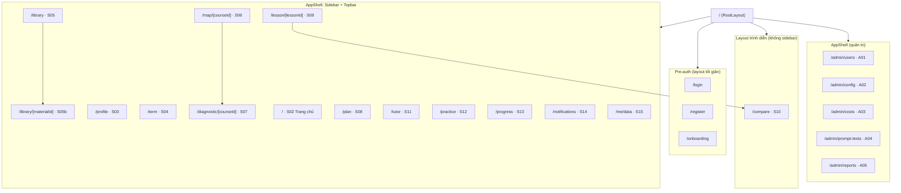
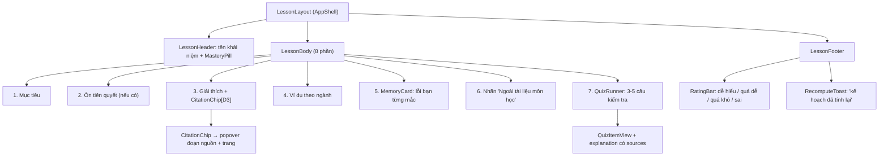
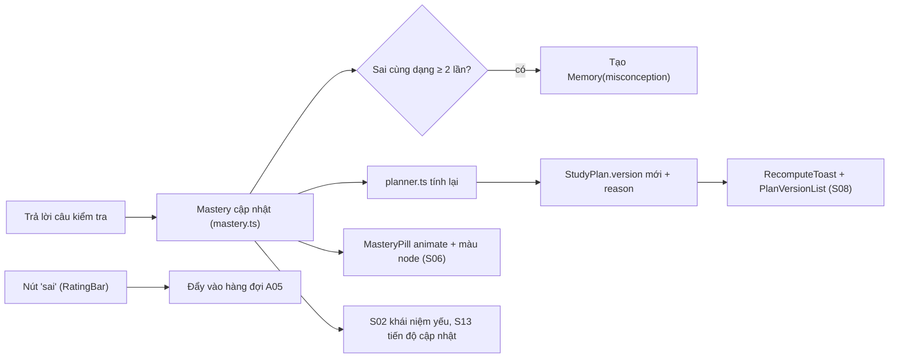
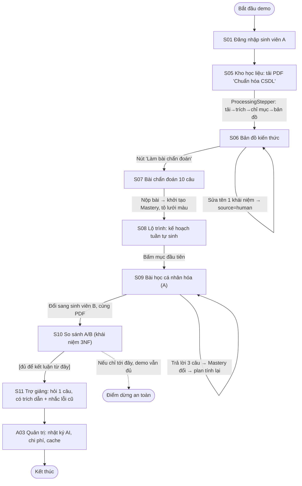

# Cấu trúc UI web (sinh viên + quản trị)

Ngày 08/09/2026. Bản đồ cấu trúc UI **dựng được**, chỉ cho **web**. Biến F1–F11
và danh sách màn ở `04-chuc-nang-ui.md` thành: kho màn hình → điều hướng →
component tái dùng → cây component từng màn → state/dữ liệu → luồng → ánh xạ chức
năng → thứ tự dựng. Không bàn màu sắc/typography (việc của web-visual-designer).

Nguồn: `04-chuc-nang-ui.md` (danh sách màn), `02-ke-hoach-demo.md` §1 (kịch bản
demo 5 phút) và §4 (mô hình dữ liệu rút gọn), `01-tom-tat-chuc-nang.md` (F1–F11).

**Quy ước:** tên thực thể dữ liệu giữ tiếng Anh đúng như §4 của `02` (`Student`,
`Material`, `Concept`, `Mastery`, `StudyPlan`, `PlanItem`, `Lesson`, `Memory`,
`AiCall`…). Component đặt tên PascalCase. Route theo App Router Next.js 15.

**Ranh giới phạm vi (đọc trước khi dựng):**
- Ngoài giai đoạn một, KHÔNG dựng: theo dõi thời gian đọc màn hình, chế độ tập
  trung, thông báo đẩy, đăng nhập Google, deadline từ Zalo/ảnh. Các màn liên
  quan (Thông báo, một phần Dữ liệu của tôi) vẫn dựng khung nhưng để trạng thái
  tĩnh/placeholder.
- Mobile và extension: chỉ liệt kê màn ở mục 8, **không phân rã**.
- Phân biệt công sức: màn **fork được từ DeepTutor** (Kho học liệu, Bản đồ, Bài
  học, Trợ giảng, Luyện tập, một phần Tiến độ/Quản trị) chủ yếu dựng lại giao
  diện. Màn **phải tự xây 100%** (Học kỳ của tôi, Gợi ý thư viện số, So sánh A/B,
  Dữ liệu của tôi) tốn công hơn — đánh dấu `[Tự xây]` trong kho màn hình.

---

## 1. Kho màn hình (screen inventory)

### 1.1 Web — Sinh viên

| Mã | Màn hình | Route | Ưu tiên | Nguồn | F liên quan | Thứ tự dựng |
|---|---|---|---|---|---|---|
| S01 | Đăng nhập / Đăng ký / Onboarding hồ sơ | `/login`, `/register`, `/onboarding` | [Lõi] | Tự xây | F1 | 1 |
| S02 | Trang chủ (dashboard tóm tắt) | `/` | [Lõi] | Một phần fork | F1,F5,F8,F9 | 1 |
| S03 | Hồ sơ | `/profile` | [Lõi] | Tự xây | F1 | 1 |
| S04 | Học kỳ của tôi (đồng bộ trường) | `/term` | [Lõi] | `[Tự xây]` | F2 | (sau lõi) |
| S05 | Kho học liệu | `/library` | [Lõi] | Fork | F3 | 2 |
| S05b | Chi tiết tài liệu | `/library/[materialId]` | [Lõi] | Fork | F3 | 2 |
| S06 | Bản đồ kiến thức (sửa được) | `/map/[courseId]` | [Lõi] | Fork | F4 | 3 |
| S07 | Bài chẩn đoán đầu vào | `/diagnostic/[courseId]` | [Lõi] | Fork | F4 | 4 |
| S08 | Lộ trình | `/plan` | [Lõi] | Fork(một phần) | F5 | 6 |
| S09 | Bài học cá nhân hóa | `/lesson/[lessonId]` | [Lõi] | Fork | F6 | 5 |
| S10 | So sánh hai sinh viên A/B | `/compare` | [Lõi] | `[Tự xây]` | F6 | 5 |
| S11 | Trợ giảng AI | `/tutor` | [Lõi] | Fork | F6 | 7 |
| S12 | Luyện tập (quiz + flashcard) | `/practice` | [Lõi]/quiz, [Phụ]/flashcard | Fork | F7 | (sau lõi) |
| S13 | Tiến độ | `/progress` | [Lõi] | Fork(một phần) | F8 | (sau lõi) |
| S14 | Thông báo | `/notifications` | [Lõi] | Tự xây (tĩnh) | F9 | (sau lõi) |
| S15 | Dữ liệu của tôi | `/me/data` | [Lõi] | `[Tự xây]` | F10 | (sau lõi) |

Ghi chú thứ tự dựng: cột "Thứ tự dựng" chỉ đánh số 1–7 cho **8 màn trong kịch bản
demo 5 phút** (mục 7). Các màn còn lại ([Lõi] nhưng không lên sân khấu demo:
S04, S12, S13, S14, S15) dựng sau, đánh dấu "(sau lõi)".

### 1.2 Web — Quản trị viên

| Mã | Màn hình | Route | Ưu tiên | Nguồn | F | Thứ tự dựng |
|---|---|---|---|---|---|---|
| A01 | Quản lý người dùng | `/admin/users` | [Lõi] | Tự xây | F11 | (kèm A02) |
| A02 | Cấu hình hệ thống & AI | `/admin/config` | [Lõi] | Fork(settings) | F11 | (sau lõi) |
| A03 | Chi phí & nhật ký AI | `/admin/costs` | [Lõi] | `[Tự xây]` | F11 | 8 |
| A04 | Bộ kiểm thử prompt | `/admin/prompt-tests` | [Phụ] | Tự xây | F11 | (dự phòng) |
| A05 | Hàng đợi "bài này sai" | `/admin/reports` | [Phụ] | Tự xây | F11 | (dự phòng) |

**A03 là màn quản trị duy nhất lên sân khấu demo (bước 8).** A01 dựng kèm vì rẻ.
A04/A05 [Phụ], làm nếu còn thời gian.

Tổng: **20 màn web** (15 sinh viên gồm 1 màn con S05b, 5 quản trị).

---

## 2. App shell (khung ứng dụng)

Layout gốc cho mọi màn sau đăng nhập: `AppSidebar` (trái) + `AppTopbar` (trên) +
vùng nội dung (`<main>`). S01 (đăng nhập/onboarding) và S10 (so sánh, chế độ trình
diễn) dùng layout tối giản không sidebar.

### 2.1 Sidebar sinh viên — 12 mục

Đúng thứ tự ở `04-chuc-nang-ui.md` (điều hướng chính):

| # | Nhãn mục | Trỏ tới màn | Badge |
|---|---|---|---|
| 1 | Trang chủ | S02 `/` | — |
| 2 | Học kỳ của tôi | S04 `/term` | chấm khi đồng bộ mới |
| 3 | Kho học liệu | S05 `/library` | số tài liệu đang xử lý |
| 4 | Bản đồ kiến thức | S06 `/map/[courseId]` | — |
| 5 | Lộ trình | S08 `/plan` | — |
| 6 | Bài học hôm nay | S09 `/lesson/…` | chấm khi có bài mới |
| 7 | Trợ giảng | S11 `/tutor` | — |
| 8 | Luyện tập | S12 `/practice` | số thẻ đến hạn ôn |
| 9 | Tiến độ | S13 `/progress` | chấm cảnh báo |
| 10 | Thông báo | S14 `/notifications` | số chưa đọc |
| 11 | Dữ liệu của tôi | S15 `/me/data` | — |
| 12 | Hồ sơ | S03 `/profile` | — |

**Không có trong sidebar** (điểm vào từ luồng khác): S01 (pre-auth), S05b (từ
S05), S07 Bài chẩn đoán (từ S06 hoặc onboarding lần đầu), S10 So sánh (từ S09,
chế độ demo). Đây là chủ ý, không phải thiếu — xem mục 9 (mâu thuẫn/ghi chú).

### 2.2 Topbar

`AppTopbar` gồm: nút thu gọn sidebar · breadcrumb/tên màn · **ContextPicker**
(môn/khái niệm/tài liệu đang chọn, đồng bộ với S11) · nút thông báo (badge số
chưa đọc) · avatar + menu (Hồ sơ, Dữ liệu của tôi, Đăng xuất). Với quản trị:
badge vai trò "Quản trị".

### 2.3 Trạng thái sidebar

- **Thu gọn (collapsed):** chỉ icon, tooltip khi hover; lưu vào localStorage.
- **Active:** mục khớp route hiện tại được tô nổi (dùng `usePathname`, so khớp
  tiền tố route).
- **Badge:** số/chấm cảnh báo (mục 3, 8, 9, 10). Nguồn: đếm `Material.status !=
  mapped` (mục 3), `PlanItem` đến hạn (mục 8), cảnh báo tiến độ (mục 9),
  `Notification` chưa đọc (mục 10 — demo để tĩnh).

### 2.4 Cây route (Mermaid)

---

## 3. Thư viện component tái dùng

Đặt ở `src/components/`. Cột "Dùng ở" chỉ màn tiêu thụ. Props/state là **hình
dạng dữ liệu**, không phải kiểu TS chính xác. `[Tự xây]` = không có sẵn ở
DeepTutor, tốn công.

| Component | Dùng ở | Props / state chính | Ghi chú |
|---|---|---|---|
| `AppSidebar` | mọi màn app | `items[]`, `collapsed`, `activePath`, `badges{}` | mục 2.1 |
| `AppTopbar` | mọi màn app | `title`, `context`, `unread`, `user` | mục 2.2 |
| `ContextPicker` | Topbar, S11 | `courses[]`, `concepts[]`, `materials[]`, `value`, `onChange` | chọn ngữ cảnh hỏi |
| `CitationChip` `[D3]` | S09, S11, S12 | `code`, `page`, `snippet`, `open` (popover) | **cốt lõi**; bấm mở đoạn nguồn + số trang |
| `ProcessingStepper` | S05, S05b | `status: uploaded\|extracted\|indexed\|mapped`, `error?` | thanh 4 bước; poll 2s |
| `MasteryPill` | S02, S06, S08, S13 | `score 0..100`, `size`, `showLabel` | viên tròn tô màu theo điểm |
| `MasteryNode` | S06, S07 | `concept`, `score`, `source: ai\|human`, `selected` | nút trên đồ thị/lưới |
| `MasteryGrid` | S07, S13 | `concepts[]`, `masteryMap`, `onSelect` | lưới ô thành thạo theo chương |
| `ConceptGraph` | S06 | `nodes[]`, `edges[] (prereq)`, `editable`, callbacks sửa | đồ thị tiên quyết |
| `ConceptCard` | S06, S13, S02 | `name`, `description`, `chapter`, `score`, `source` | thẻ khái niệm |
| `PlanItem` | S02, S08 | `concept`, `date`, `minutes`, `status`, `lessonId?`, `onOpen` | mục lịch tuần |
| `PlanVersionList` | S08 | `versions[] {version, reason, createdAt}` | lịch sử + lý do đổi |
| `ChatMessage` | S11 | `role`, `content`, `citations[]`, `memoryRefs[]` | bong bóng chat có `CitationChip` |
| `MemoryCard` | S09, S11 | `kind: misconception\|effective_explanation\|preference`, `text`, `evidence` | thẻ "nhớ bạn từng nhầm…" |
| `RatingBar` | S09 | `value`, `onRate('easy'\|'tooEasy'\|'tooHard'\|'wrong')` | 4 nút đánh giá cuối bài |
| `QuizRunner` | S07, S09, S12 | `items[]`, `mode`, `onSubmit`, `progress` | chạy bộ câu hỏi |
| `QuizItemView` | S07, S09, S12 | `kind`, `question`, `options[]`, `answer`, `explanation`, `sources[]` | 1 câu, nhiều dạng |
| `CompareColumn` | S10 | `student`, `profileSummary`, `lesson`, `highlightDiff` | một cột A hoặc B |
| `ProfileSummaryCard` | S10, S03 | `major`, `goal`, `preferredFormat`, `sessionMinutes` | vì sao bài khác nhau |
| `StatCard` | S02, S13, A03 | `label`, `value`, `trend?`, `icon?` | thẻ số liệu |
| `QuickActionCard` | S02 | `label`, `href`, `icon` | nút nhanh trang chủ |
| `SyncStatusBanner` | S04 | `lastSyncAt`, `readItems[]`, `onEditRow` | "hệ thống đã đọc gì" |
| `LibraryDocCard` | S05 | `material`, `status`, `source`, `onOpen` | thẻ tài liệu + stepper |
| `PageViewer` | S05b | `pages[]`, `currentPage` | xem PDF theo trang |
| `ChunkList` | S05b | `chunks[] {ord, page, text}` | danh sách đoạn đã cắt |
| `ConfirmExtract` | S04, S08 | `rawText`, `aiResult`, `onConfirm`, `onEdit` | `[Tự xây]` văn bản gốc cạnh kết quả AI |
| `NotificationCard` | S14 | `type`, `title`, `time`, `read` | thẻ thông báo |
| `AlertBanner` | S13, S02 | `kind: behind\|examSoon`, `message`, `action?` | 2 loại cảnh báo |
| `ProgressChart` | S13 | `series[]`, `type: time\|planVsActual` | biểu đồ (theo skill dataviz) |
| `CostChart` | A03 | `byDay[]`, `byStudent[]` | biểu đồ chi phí AI |
| `AiCallLogTable` | A03 | `rows[] (task,model,tokens,cost,promptVersion,ok)` | nhật ký gọi AI |
| `UserRow` | A01 | `user`, `onLock`, `onSetRole` | dòng người dùng |
| `EmptyState` | mọi màn | `icon`, `title`, `hint`, `action?` | trạng thái rỗng |
| `LoadingState` | mọi màn | `variant: skeleton\|spinner` | trạng thái tải |
| `ErrorState` | mọi màn | `message`, `onRetry` | trạng thái lỗi |
| `ConfirmDialog` | S06, S15, A01 | `title`, `body`, `danger`, `onConfirm` | hộp xác nhận xóa/gộp |

**Component tái dùng đắt giá nhất (dựng kỹ, dùng nhiều):** `CitationChip`,
`MasteryPill`/`MasteryNode`, `ProcessingStepper`, `QuizRunner`. Bốn cái này xuất
hiện xuyên suốt demo, làm chuẩn trước.

Tổng: **~35 component tái dùng** (gồm 3 trạng thái Loading/Empty/Error dùng khắp).

---

## 4. Cây component từng màn (8 màn theo thứ tự demo)

Mỗi màn: **cây component** (layout → section → component → phần tử tương tác) ·
**dữ liệu đọc vào** · **hành động** · **trạng thái** (loading/rỗng/lỗi/thành công)
· **lan state** (state đổi thì tính lại tới đâu). Component in đậm là tái dùng từ
mục 3.

### 4.1 Màn 1 — Đăng nhập (S01) / Hồ sơ (S03) / Trang chủ (S02)

**S01 — Đăng nhập / Đăng ký / Onboarding**
- `AuthLayout` (tối giản, không sidebar)
  - Section: Form
    - `LoginForm`: input email, input mật khẩu, nút "Đăng nhập", nút "Đăng nhập
      Google" (ngoài demo — để disabled + tooltip), link sang `/register`.
    - `RegisterForm`: email, mật khẩu, xác nhận, nút "Tạo tài khoản".
  - Section: Onboarding (chỉ sau đăng ký lần đầu, route `/onboarding`)
    - `GoalField` (mục tiêu học kỳ), `FreeSlotGrid` (lưới 7 ngày × khung giờ,
      bấm chọn ô), `FormatPicker` (đọc / ví dụ thực tế / bài tập),
      `SessionMinutesField`.
- Dữ liệu đọc vào: không (form). Onboarding ghi `Student{goal, freeSlots,
  preferredFormat, sessionMinutes}`.
- Hành động: đăng nhập → set cookie JWT → điều hướng S02. Đăng ký → `/onboarding`.
  Lưu onboarding → S02.
- Trạng thái: loading (nút quay), lỗi (sai mật khẩu → thông báo dưới form),
  thành công (chuyển màn).
- Lan state: hoàn tất onboarding tạo hồ sơ → mọi màn cá nhân hóa đọc được
  `preferredFormat`/`sessionMinutes` (ảnh hưởng S09, S08).

**S03 — Hồ sơ**
- `AppShell`
  - Section: Thông tin trường (chỉ đọc) — `ProfileSummaryCard`: ngành, khóa, học
    kỳ (từ cổng đào tạo, badge "chỉ đọc").
  - Section: Tùy chọn học tập (sửa được) — `GoalField`, `FreeSlotGrid`,
    `FormatPicker`, `SessionMinutesField`, nút "Lưu".
- Dữ liệu đọc vào: `Student` của người đang đăng nhập.
- Hành động: sửa 4 trường → Lưu.
- Trạng thái: loading skeleton; thành công (toast "Đã lưu"); lỗi (giữ giá trị,
  báo lỗi).
- Lan state: đổi `freeSlots`/`sessionMinutes` → **planner tính lại** → S08 có
  `StudyPlan.version` mới; đổi `preferredFormat` → bài học sinh sau này khác hình
  dạng (S09).

**S02 — Trang chủ (dashboard tóm tắt)**
- `AppShell`
  - Section: Việc hôm nay — danh sách `PlanItem` (status của ngày), mỗi mục bấm
    mở S09.
  - Section: Sắp thi — `StatCard` môn + số ngày còn lại (đọc `Enrollment.examDate`).
  - Section: Khái niệm còn yếu — danh sách `ConceptCard` rút gọn + `MasteryPill`
    (`Mastery.score < 60`).
  - Section: Nút nhanh — `QuickActionCard` × 3: "Học bài tiếp theo" → S09, "Mở
    trợ giảng" → S11, "Làm quiz" → S12.
  - `AlertBanner` (nếu có cảnh báo tụt tiến độ / sắp thi).
- Dữ liệu đọc vào: `PlanItem` hôm nay, `Enrollment` (ngày thi gần nhất),
  `Mastery` (điểm < 60), cờ cảnh báo.
- Hành động: bấm mục kế hoạch, bấm nút nhanh.
- Trạng thái: loading (skeleton các thẻ); **rỗng** (chưa có kế hoạch →
  `EmptyState` "Chưa có kế hoạch, tải tài liệu để bắt đầu" → nút sang S05); lỗi.
- Lan state: là màn **đọc** tổng hợp — mọi thay đổi Mastery/Plan ở màn khác đều
  làm S02 tính lại khi quay về.

### 4.2 Màn 2 — Kho học liệu (S05) + Chi tiết tài liệu (S05b)

**S05 — Kho học liệu**
- `AppShell`
  - Section: Thanh công cụ — nút "Tải lên" (PDF/text/markdown), ô "Dán link",
    nút "Nhập từ thư viện số" (mở qua extension; ngoài demo → tooltip).
  - Section: Danh sách theo môn — nhóm theo `Course`, mỗi tài liệu là
    `LibraryDocCard`:
    - tên · loại (`kind`) · nguồn (tải lên / thư viện số / link)
    - **`ProcessingStepper`** 4 bước: đã tải → đã trích xuất → đã lập chỉ mục →
      đã có bản đồ (đọc `Material.status`)
    - nút mở → S05b.
  - Section (tự xây): Gợi ý thư viện số — thẻ bài giảng khớp môn (OAI-PMH) + nút
    "nhập". `[Tự xây]`, [Phụ] trong demo.
- Dữ liệu đọc vào: `Material[]` (theo `studentId`), nhóm theo `courseId`.
- Hành động: tải file, dán link, mở tài liệu, "nhập từ thư viện số".
- Trạng thái: loading; **rỗng** (`EmptyState` "Chưa có tài liệu" + nút tải lên);
  **đang xử lý** (`ProcessingStepper` chạy, poll mỗi 2s cập nhật `status`); lỗi
  (`Material.error` → stepper đỏ + nút thử lại).
- Lan state: tài liệu đạt `status = mapped` → **`Concept` mới sinh** → cập nhật
  S06 (bản đồ) và badge sidebar mục 3; mở khóa nút "Làm bài chẩn đoán" ở S06.

**S05b — Chi tiết tài liệu**
- `AppShell` (breadcrumb: Kho học liệu / [tên tài liệu])
  - Section: Thanh trạng thái — `ProcessingStepper`.
  - Section: Xem trang — `PageViewer` (điều hướng trang).
  - Section: Đoạn đã cắt — `ChunkList` (`Chunk{ord, page, text}`), bấm đoạn →
    nhảy trang tương ứng.
- Dữ liệu đọc vào: `Material` + `Chunk[]` của tài liệu.
- Hành động: lật trang, chọn đoạn.
- Trạng thái: loading; rỗng (chưa trích xuất xong → chỉ hiện stepper); lỗi.
- Lan state: chỉ đọc, không đổi state hệ thống.

### 4.3 Màn 3 — Bản đồ kiến thức (S06, sửa được)

- `AppShell`
  - Section: Thanh môn/chương — chọn `Course`, lọc theo `chapter`.
  - Section: Đồ thị — **`ConceptGraph`**:
    - node = **`MasteryNode`** (tô màu theo `Mastery.score`, nhãn `source:
      ai|human`)
    - cạnh = mũi tên tiên quyết (`ConceptPrereq`)
    - toolbar sửa: Thêm khái niệm · Nối tiên quyết · Gộp hai · Xóa.
  - Section: Bảng chi tiết khái niệm đang chọn — `ConceptCard` mở rộng: đổi tên,
    sửa mô tả (inline edit), `MasteryPill`.
  - `ConfirmDialog` cho Xóa / Gộp.
- Dữ liệu đọc vào: `Concept[]`, `ConceptPrereq[]`, `Mastery` map (theo student).
- Hành động: sửa tên / mô tả / gộp / xóa / thêm / nối tiên quyết; nút "Làm bài
  chẩn đoán" → S07 (chỉ bật khi đã có bản đồ).
- Trạng thái: loading (skeleton đồ thị); **rỗng** (`EmptyState` "Chưa có bản đồ,
  chờ tài liệu xử lý xong" → link S05); lỗi.
- Lan state: **mọi thao tác sửa đặt `Concept.source = human`** ("người sửa luôn
  thắng"). Đổi tên/gộp/xóa → tính lại đồ thị + đồng bộ tên ở S09, S13, S02. Sửa
  cấu trúc tiên quyết → **planner tính lại** (thay đổi `soKhaiNiemPhuThuoc`) →
  S08 phiên bản mới.

### 4.4 Màn 4 — Bài chẩn đoán (S07) + lưới thành thạo

- `DiagnosticLayout` (tập trung, ẩn sidebar khi làm bài)
  - Section: Làm bài — **`QuizRunner`**: thanh tiến độ (câu k/N),
    `QuizItemView` từng câu (10–15 câu trải đều chương), nút "Nộp bài".
  - Section: Kết quả (sau nộp) — **`MasteryGrid`** tô màu lần đầu (theo chương)
    + tóm tắt điểm yếu (danh sách `ConceptCard` < 60) + nút "Xem lộ trình" → S08.
- Dữ liệu đọc vào: `QuizItem[]` sinh cho chẩn đoán (theo `Concept` của môn).
- Hành động: chọn đáp án từng câu, nộp bài.
- Trạng thái: loading (đang sinh câu hỏi — có thể lâu, hiện tiến trình); đang làm;
  **thành công** (hiện lưới màu); lỗi (sinh câu thất bại → thử lại).
- Lan state: **nộp bài → khởi tạo `Mastery` cho mọi `Concept`** (điểm 0..100) →
  lan tới S06 (màu node), S02 (khái niệm yếu), và **kích hoạt planner** sinh
  `StudyPlan` đầu tiên (S08). Đây là mắt xích "chẩn đoán → thành thạo → kế hoạch".

### 4.5 Màn 5 — Bài học cá nhân hóa (S09) + So sánh A/B (S10) — quan trọng nhất

**S09 — Bài học cá nhân hóa**

Cây component (Mermaid):

- Dữ liệu đọc vào: `Lesson{content json, citations json}` + `Concept` +
  `Mastery` hiện tại + `Memory` (misconception đang `active`) + `QuizItem[]` gắn
  bài + `Chunk` cho popover trích dẫn.
- Hành động: đọc; bấm `CitationChip` mở đoạn nguồn; trả lời 3–5 câu kiểm tra;
  bấm 1 trong 4 nút `RatingBar`.
- Trạng thái: loading (bài đang sinh — 10–20s, có tiến trình); **thành công**
  (bài hiện đủ 8 phần); lỗi grounding (không đạt kiểm tra bám nguồn sau 1 lần
  sinh lại → `ErrorState` "Không tạo được bài đạt chuẩn nguồn", không giao bài);
  rỗng (không dùng — luôn có khái niệm mục tiêu).
- Lan state (chuỗi cốt lõi của demo):

**S10 — So sánh hai sinh viên A/B** `[Tự xây]`, phục vụ demo luận điểm
- `CompareLayout` (không sidebar, 2 cột)
  - `CompareColumn` A và `CompareColumn` B cạnh nhau, cùng khái niệm (vd "3NF"):
    - `ProfileSummaryCard` trên mỗi cột (vì sao khác)
    - bài học rút gọn của mỗi bên, **làm nổi bật phần khác**: mở đầu, giải thích,
      "lỗi từng mắc", số câu kiểm tra (`highlightDiff = true`).
  - Thanh chọn khái niệm để so (nếu có nhiều).
- Dữ liệu đọc vào: 2 `Lesson` (của student A và B) cùng `conceptId` + 2
  `ProfileSummaryCard` từ `Student`.
- Hành động: đổi khái niệm so sánh; cuộn đồng bộ 2 cột (tùy chọn).
- Trạng thái: loading; rỗng (chưa có đủ 2 bài → gợi ý sinh bài cho B); lỗi.
- Lan state: chỉ đọc, không đổi state. Đây là màn **trình bày**, không nhập liệu.

### 4.6 Màn 6 — Lộ trình (S08)

- `AppShell`
  - Section: Lịch tuần — lưới ngày × khung giờ, mỗi ô = **`PlanItem`** (khái
    niệm, ngày, thời lượng; không đè giờ lên lớp). Bấm mục → S09.
  - Section: Lý do & phiên bản — `RecomputeReason` (1 câu: "Dồn về Phụ thuộc hàm
    vì thi sau 5 ngày và mức 35/100") + **`PlanVersionList`** (danh sách
    `StudyPlan.version`).
  - Section: Nhập deadline — ô dán tin nhắn/ảnh → **`ConfirmExtract`** (văn bản
    gốc cạnh kết quả AI rút ra). `[Tự xây]`, deadline-từ-ảnh ngoài demo → chỉ
    khung nhập tay.
- Dữ liệu đọc vào: `StudyPlan` mới nhất + `PlanItem[]` + `Enrollment.examDate` +
  `freeSlots` + `Mastery`.
- Hành động: bấm mục vào bài học; đổi ngày thi (nhập tay); dán deadline.
- Trạng thái: loading; **rỗng** (chưa làm chẩn đoán → `EmptyState` "Làm bài
  chẩn đoán để hệ thống lập kế hoạch" → S07); lỗi.
- Lan state: đổi ngày thi / thêm deadline → **planner tính lại** → `version` mới,
  `reason` mới → cập nhật lịch + `PlanVersionList` + S02. Ngược lại, S08 là nơi
  **hiển thị kết quả** khi planner được kích từ S07/S09/S03/S06.

### 4.7 Màn 7 — Trợ giảng AI (S11)

- `AppShell`
  - Section: Chọn ngữ cảnh — **`ContextPicker`** (đang hỏi trên môn / khái niệm /
    tài liệu nào).
  - Section: Hội thoại — danh sách **`ChatMessage`**:
    - câu trả lời có **`CitationChip`** (mở đoạn nguồn)
    - khi nhắc lỗi cũ hiện **`MemoryCard`** "nhớ bạn từng nhầm…"
    - phần ngoài tài liệu mở đầu "Ngoài tài liệu môn học:".
  - Section: Ô nhập — textarea + nút gửi (stream).
- Dữ liệu đọc vào: `TutorMessage[]` (lịch sử), `Memory` đang `active`, `Chunk`
  tìm được (toàn văn), ngữ cảnh từ `ContextPicker`.
- Hành động: chọn ngữ cảnh, gõ câu hỏi, gửi, bấm chip trích dẫn.
- Trạng thái: loading (đang stream, hiện con trỏ gõ); rỗng (`EmptyState` gợi ý
  câu hỏi mẫu); lỗi (gọi AI thất bại → thử lại).
- Lan state: câu hỏi/trả lời ghi `TutorMessage`; nếu lộ nhầm lẫn có thể ghi
  `Memory` mới → lan S09 (phần "lỗi từng mắc" lần sau). Không đổi `Mastery`
  trực tiếp trong demo.

### 4.8 Màn 8 — Quản trị: Chi phí & nhật ký (A03)

- `AppShell` (điều hướng quản trị: Người dùng · Cấu hình AI · Chi phí & nhật ký ·
  Kiểm thử prompt · Bài bị báo sai)
  - Section: Tổng quan — `StatCard` × N: tổng chi phí hôm nay, số lời gọi, tỉ lệ
    lỗi, cache tiết kiệm.
  - Section: Biểu đồ — **`CostChart`**: chi phí theo ngày + theo người.
  - Section: Nhật ký gọi AI — **`AiCallLogTable`**: tác vụ, mô hình, token
    (vào/ra/cache), chi phí, `promptVersion`, thành công/lỗi (đọc `AiCall`).
  - Section: Nhật ký lỗi hệ thống — bảng lỗi (rút gọn).
- Dữ liệu đọc vào: `AiCall[]` (nhóm theo ngày, theo `studentId`).
- Hành động: lọc theo ngày/người/tác vụ; mở chi tiết một dòng.
- Trạng thái: loading (skeleton bảng); rỗng ("Chưa có lời gọi nào"); lỗi.
- Lan state: chỉ đọc. **Bằng chứng cache** ở demo: sinh viên A rồi B trên cùng
  đoạn nguồn → dòng thứ hai có `cacheReadTokens > 0` (nêu bước 8 kịch bản).

> A01 (Người dùng): `UserRow` danh sách + tìm/lọc + khóa/mở + đặt vai trò
> (`ConfirmDialog`). A02 (Cấu hình): danh sách trang được phép, chọn model theo
> tác vụ, hạn mức chi phí, tham số thuật toán (ngưỡng yếu, hệ số thành thạo) —
> đây là nguồn cấu hình cho `config.ts`. A04/A05 [Phụ]: chỉ dựng khung khi dư giờ.

---

## 5. Sơ đồ luồng màn hình (bám kịch bản demo 5 phút)

Theo `02-ke-hoach-demo.md` §1. **Lưu ý thứ tự:** trong kịch bản, Lộ trình (S08)
xuất hiện **trước** Bài học (S09) — kế hoạch sinh ra rồi mới bấm mục đầu để vào
bài. (Thứ tự *dựng* ở mục 1 lại đặt S09 trước S08 vì S09 là màn khó nhất, nên làm
sớm — hai thứ tự này khác nhau có chủ ý, xem mục 9.)

Điều kiện chuyển chính:
- S05 → S06: `Material.status = mapped` (có bản đồ) mới mở được S06.
- S06 → S07: chỉ bật khi đã có `Concept` của môn.
- S07 → S08: sau khi `Mastery` khởi tạo, planner sinh `StudyPlan` đầu tiên.
- S09 → S10: cần đã có `Lesson` của cả A và B cho cùng `conceptId`.
- S11, A03: phần "cho đẹp" (bước 7–8); S10 là điểm dừng an toàn của demo.

---

## 6. Đặc tả dữ liệu demo dùng chung (mọi mockup dùng bộ này)

Bộ dữ liệu chuẩn để mọi mockup nhất quán. Bám mô hình `02` §4 và Bảng 7.3
(hai hồ sơ đối lập). Môn: **Cơ sở dữ liệu**; chương: **Chuẩn hóa CSDL**.

### 6.1 Hai sinh viên đối lập

| Trường | Sinh viên A (nền tảng yếu) | Sinh viên B (nền tảng tốt) |
|---|---|---|
| `fullName` | Nguyễn Văn An | Trần Thị Bình |
| `studentCode` | UTT-CN-01 | UTT-CN-02 |
| `major` | Công nghệ thông tin | Kỹ thuật phần mềm |
| `cohort` | K64 | K63 |
| `goal` | "Qua môn, hiểu để làm bài tập" | "Điểm A, hiểu sâu để thi cao học" |
| `freeSlots` | tối 20–22h các ngày, cuối tuần | sáng sớm 6–8h, trưa 12–13h |
| `preferredFormat` | ví dụ thực tế + bài tập | đọc lý thuyết + chứng minh |
| `sessionMinutes` | 30 | 60 |

Hệ quả UI (S09/S10): bài của A ngắn, nhiều ví dụ bảng dữ liệu cụ thể, phần "lỗi
từng mắc" dày; bài của B dài hơn, thiên định nghĩa hình thức và điều kiện, ít
phần ôn tiên quyết.

### 6.2 Môn và chương

- `Course`: id `c-db`, code `INT1234`, name "Cơ sở dữ liệu", lecturer "TS. Lê Văn
  C", term "20261".
- `Enrollment` (cả A và B): `examDate` = **20/09/2026** (còn 12 ngày tính từ
  08/09), `examRoom` "A2-301", `grade` null.
- `Material`: id `m-norm`, title "Chương 4 — Chuẩn hóa cơ sở dữ liệu", kind
  "pdf", `status` "mapped" (đã xử lý xong để mockup có dữ liệu).

### 6.3 Tám khái niệm + mastery + tiên quyết

Chương "Chuẩn hóa CSDL", `ord` theo thứ tự dạy. Mastery 0..100.

| id | Khái niệm | `ord` | Tiên quyết (prereq) | Mastery A | Mastery B | `source` |
|---|---|---|---|---|---|---|
| k1 | Phụ thuộc hàm (FD) | 1 | — | 30 | 85 | ai |
| k2 | Khóa & khóa dự tuyển | 2 | k1 | 40 | 80 | human |
| k3 | Phụ thuộc hàm đầy đủ | 3 | k1 | 25 | 78 | ai |
| k4 | Phụ thuộc bắc cầu | 4 | k1 | 20 | 82 | ai |
| k5 | Dạng chuẩn 1 (1NF) | 5 | k2 | 55 | 90 | ai |
| k6 | Dạng chuẩn 2 (2NF) | 6 | k3, k5 | 35 | 75 | ai |
| k7 | Dạng chuẩn 3 (3NF) | 7 | k4, k6 | 15 | 60 | ai |
| k8 | Dạng chuẩn Boyce–Codd (BCNF) | 8 | k7 | 10 | 45 | ai |

Cạnh tiên quyết (cho `ConceptGraph`): k1→k2, k1→k3, k1→k4, k2→k5, k3→k6, k5→k6,
k4→k7, k6→k7, k7→k8. Ngưỡng yếu < 60: A yếu 7/8 (chỉ k5 sát ngưỡng); B yếu 2/8
(k7, k8). Đây là lý do kế hoạch A dồn vào chuỗi k1→k7, kế hoạch B chỉ chạm k7,k8.

Khái niệm mang màu demo bản đồ: k2 mang nhãn `source = human` để minh họa "người
sửa luôn thắng" (thao tác sửa tên ở bước 2 kịch bản).

### 6.4 Kế hoạch tuần mẫu (StudyPlan của A)

`StudyPlan{ weekStart: 08/09/2026, version: 2, reason: "Dồn về Phụ thuộc hàm và
3NF vì thi sau 12 ngày và cả hai đang dưới 35/100" }`. `PlanItem` (không đè giờ
lên lớp, khớp `freeSlots` tối):

| Ngày | Khái niệm | `minutes` | `status` |
|---|---|---|---|
| 08/09 tối | k1 Phụ thuộc hàm | 30 | done |
| 09/09 tối | k4 Phụ thuộc bắc cầu | 30 | doing |
| 10/09 tối | k3 Phụ thuộc hàm đầy đủ | 30 | todo |
| 12/09 tối | k6 2NF | 30 | todo |
| 14/09 sáng (CN) | k7 3NF | 60 | todo |
| 16/09 tối | k7 3NF (ôn) | 30 | todo |
| 18/09 tối | k8 BCNF | 30 | todo |

`PlanVersionList`: v1 (kế hoạch gốc sau chẩn đoán) → v2 ("tính lại sau khi trả
lời sai câu 3NF" — dùng cho hoạt cảnh bước 5 kịch bản).

### 6.5 Memory mẫu (2–3 misconception cho A)

| id | `kind` | `conceptId` | `text` | `evidence` | `active` |
|---|---|---|---|---|---|
| mem1 | misconception | k7 | "Nhầm 2NF là đủ cho 3NF — bỏ qua điều kiện phụ thuộc bắc cầu" | sai 2 lần quiz 3NF | true |
| mem2 | misconception | k4 | "Coi phụ thuộc bắc cầu như phụ thuộc hàm thường, không nhận ra trung gian" | sai câu chẩn đoán k4 | true |
| mem3 | effective_explanation | k7 | "Hiểu nhanh khi giải thích bằng bảng dữ liệu cụ thể có dòng ví dụ" | đánh giá 'dễ hiểu' sau bài có ví dụ bảng | true |

mem1/mem2 hiện trong `MemoryCard` phần "lỗi bạn từng mắc" của bài học A (S09) và
khi trợ giảng nhắc lỗi cũ (S11, bước 7 kịch bản). mem3 dùng để prompt định hình
bài A thiên ví dụ bảng.

---

## 7. Ánh xạ ngược màn ↔ chức năng F & usecase

Đảm bảo không thừa không thiếu so với F1–F11.

| F | Chức năng | Màn web | Usecase chính |
|---|---|---|---|
| F1 | Tài khoản & hồ sơ | S01, S03, S02 | Đăng ký, Đăng nhập, Onboarding hồ sơ, Sửa tùy chọn học tập |
| F2 | Đồng bộ dữ liệu trường | S04 | Xem môn/TKB/lịch thi/điểm, Sửa tay dòng đồng bộ, Nhập môn thủ công, Gợi ý bài giảng thư viện số |
| F3 | Kho học liệu | S05, S05b | Tải tài liệu, Dán link, Nhập từ thư viện số, Xem xử lý 4 bước, Xem trang & đoạn |
| F4 | Bản đồ kiến thức & thành thạo | S06, S07 | Xem/sửa bản đồ, Nối tiên quyết, Gộp/xóa khái niệm, Làm bài chẩn đoán, Tô lưới thành thạo |
| F5 | Lộ trình | S08 | Sinh kế hoạch tuần, Tính lại kèm lý do, Xem phiên bản, Nhập deadline |
| F6 | Trợ giảng & bài học | S09, S10, S11 | Sinh bài cá nhân hóa, Mở trích dẫn, Đánh giá bài, So sánh A/B, Chat có trích dẫn & trí nhớ |
| F7 | Luyện tập | S12 | Làm quiz nhiều dạng, Xem giải thích có trích dẫn, Flashcard [Phụ] |
| F8 | Tiến độ | S13, S02 | Xem bản đồ thành thạo, Biểu đồ thời gian, Tiến độ vs kế hoạch, Nhận cảnh báo |
| F9 | Thông báo | S14, S02 | Xem trung tâm thông báo, Cài đặt loại/khung giờ (demo: tĩnh) |
| F10 | Riêng tư & dữ liệu | S15 | Xem dữ liệu đã thu, Tải về, Xóa tài khoản, Tạm dừng theo dõi, Quản trang phép extension |
| F11 | Quản trị | A01–A05 | Quản người dùng, Cấu hình AI/chi phí, Xem nhật ký & chi phí, Kiểm thử prompt, Xử lý bài báo sai |

**Kiểm tra thừa/thiếu:** mọi F đều có màn; mọi màn đều gắn ≥ 1 F. Component không
gắn F trực tiếp (`AppSidebar`, `AppTopbar`, Loading/Empty/Error) là hạ tầng dùng
chung — chấp nhận.

### 7.1 Thứ tự dựng UI (tóm tắt theo kịch bản demo)

1. **S01, S03, S02** (đăng nhập, hồ sơ, trang chủ) + app shell.
2. **S05, S05b** (kho học liệu + `ProcessingStepper`).
3. **S06** (bản đồ, sửa được).
4. **S07** (chẩn đoán + `MasteryGrid`).
5. **S09, S10** (bài học cá nhân hóa + so sánh A/B — khó nhất, làm sớm).
6. **S08** (lộ trình).
7. **S11** (trợ giảng).
8. **A03** (quản trị chi phí & nhật ký) + A01 kèm.

Sau lõi (không lên sân khấu nhưng vẫn [Lõi]): S04, S12, S13, S14, S15. Dự phòng:
A04, A05, flashcard, mobile.

---

## 8. Mobile & Extension (chỉ liệt kê, không phân rã)

Theo Phụ lục A và mục C/D của `04`. Ngoài phạm vi phân rã của tài liệu này; ghi
để trọn hệ.

**Mobile (nhẹ) — kênh ôn tập & thông báo, không bắt buộc trong demo:**
- M1 Hôm nay (mục kế hoạch của ngày, đánh dấu hoàn thành)
- M2 Ôn tập (flashcard + quiz nhanh) — [Lõi của mobile]
- M3 Bài học ngắn (đọc lại bài đã sinh, rút gọn)
- M4 Trợ giảng (chat nhanh)
- M5 Lộ trình (xem kế hoạch tuần, đánh dấu hoàn thành)
- M6 Thông báo đẩy (kênh chính nhận nhắc)
- M7 Hồ sơ (xem/sửa cơ bản; tạm dừng, xóa dữ liệu)

**Extension (mỏng) — phần lớn chạy nền:**
- X1 Thanh bên trợ giảng (hỏi đáp theo trang, có trích dẫn)
- X2 Menu bôi đen (giải thích / tóm tắt / tạo flashcard)
- X3 Nút "nhập vào hệ thống" (khi mở bài giảng thư viện số)
- X4 Đọc cổng đào tạo (chạy nền, không giao diện, chỉ báo khi xong)
- X5 Màn xin phép khi cài (nói rõ đọc gì, trang nào, để làm gì; nút tạm dừng)

---

## 9. Mâu thuẫn / thiếu phát hiện trong `04-chuc-nang-ui.md`

1. **Sidebar 12 mục vs 15 màn sinh viên — không mâu thuẫn nhưng cần chốt.** Ba
   màn không có mục sidebar: Bài chẩn đoán (S07), So sánh A/B (S10), và Đăng nhập
   (S01). Chúng là *sub-flow* (S07 vào từ S06/onboarding; S10 vào từ S09; S01
   pre-auth). Đã xử lý ở mục 2.1. Cần người dự án xác nhận cách này.

2. **"Bài học hôm nay" (nhãn sidebar) vs "Bài học cá nhân hóa" (tên màn S09).**
   Hai tên cho cùng một màn. Đề xuất: nhãn sidebar "Bài học hôm nay" trỏ tới S09
   với `lessonId` của `PlanItem` đang `doing`; nếu chưa có thì rỗng → gợi ý mở
   lộ trình.

3. **Thứ tự Lộ trình vs Bài học lệch giữa hai nguồn.** `04` §Thứ tự dựng đặt Bài
   học (mục 5) trước Lộ trình (mục 6); nhưng kịch bản demo `02` §1 cho Lộ trình
   xuất hiện *trước* (bước 4 kế hoạch → bước 5 bài học). Tài liệu này giữ cả hai:
   *thứ tự dựng* theo `04` (S09 trước S08 vì khó), *thứ tự luồng* theo `02` (S08
   trước S09). Không phải lỗi, nhưng dễ nhầm — đã chú thích ở mục 5.

4. **F7 flashcard: `04` ghi [Phụ], `01` ghi [Cốt lõi].** `04` mục 12 đánh
   flashcard **[Phụ]**, còn `01` F7 xếp cả quiz+flashcard [Cốt lõi]. Bám `04`
   (gần UI hơn, và `02` §2 để flashcard vào dự phòng): quiz [Lõi], flashcard
   [Phụ]. Đã theo cách này ở mục 1.

5. **F3 thu hẹp phạm vi so với `01`.** `01` F3 nêu Word/PPT/ảnh/OCR/YouTube;
   `02` §2 cắt xuống chỉ PDF/text/markdown cho demo. UI (S05) chỉ dựng nút tải
   PDF/text/markdown + ô dán link; **không** dựng ô upload ảnh/OCR/YouTube. Nêu
   rõ để không phịa nút thừa.

6. **F2 (S04) & Gợi ý thư viện số & F10 (S15): [Lõi] nhưng `02` §2 để ngoài
   demo/dự phòng.** Vẫn dựng khung (đánh `[Tự xây]`) nhưng dữ liệu tĩnh/placeholder;
   không cần backend đồng bộ thật cho mockup. Deadline-từ-ảnh (S08) chỉ để khung
   nhập tay.

7. **Thiếu định nghĩa "phiên bản kế hoạch" hiển thị thế nào.** `04` mục 8 nói
   "danh sách phiên bản kế hoạch" nhưng không rõ so sánh giữa các version. Đề
   xuất tối thiểu: `PlanVersionList` chỉ liệt kê `version + reason + createdAt`,
   chưa cần diff hai bản (để giai đoạn sau).

