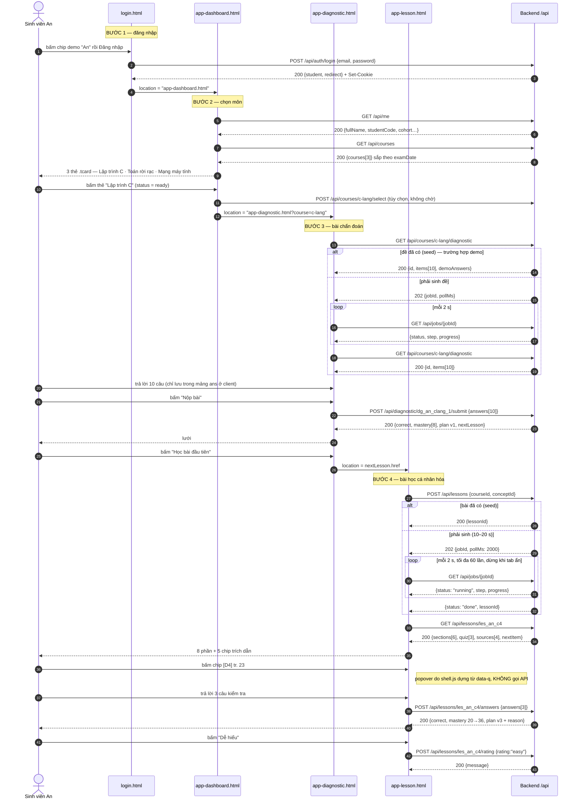

# Hợp đồng dữ liệu ui-v2 ↔ backend — luồng demo 4 bước

Ngày 11/09/2026. Phạm vi: **đúng bốn bước** đăng nhập → chọn môn → bài chẩn đoán →
bài học cá nhân hóa. Môn demo: **Lập trình C** (thay Cơ sở dữ liệu).

Nguồn: `05-cau-truc-ui.md` (cấu trúc UI, state từng màn), `02-ke-hoach-demo.md` §4
(mô hình dữ liệu) và §5 (ba thuật toán thuần). Tên thực thể giữ tiếng Anh:
`Student`, `Course`, `Material`, `Chunk`, `Concept`, `Mastery`, `Memory`,
`Lesson`, `QuizItem`, `Attempt`, `AiCall`.

Frontend là HTML tĩnh + vanilla JS ở `ui-v2/`. Backend chưa chọn Node hay Python.
Tài liệu này là ranh giới để hai bên làm độc lập.

---

## 0. Kết luận (8 dòng)

1. Bước "chọn môn" đặt trên **`app-dashboard.html`**, tái dùng khối `.trio` sẵn có:
   ba thẻ `.tcard` "hôm nay" thành ba **thẻ môn**. Không thêm CSS, thêm đúng 2 `id`.
2. Phương án loại bỏ: nhóm theo môn trong `app-library.html` — tốn thêm HTML nhóm,
   thêm CSS, lại kéo dài demo thêm một cú bấm; kho học liệu là nơi của *tài liệu*, không phải *môn*.
3. **12 endpoint**: 9 bắt buộc cho bốn bước, 3 tùy chọn (`logout`, `select`, `rating`).
4. Sinh bài học chạy 10–20 giây → **`202` + `jobId` + poll `GET /api/jobs/{id}` mỗi 2 giây**.
   Không SSE (lý do ở §3.8).
5. Planner **không cần job**: là hàm thuần, chạy dưới 10 ms → tính đồng bộ ngay trong
   `POST /api/diagnostic/{id}/submit`.
6. Chip trích dẫn **không phải sửa `shell.js`**: backend trả `{code, page, snippet}`,
   JS dựng `<button class="cite" data-src data-page data-q>`, popover toàn cục bắt sẵn.
7. Đổi nội dung mẫu sang Lập trình C: **~40 khối chữ trên 4 màn**, nặng nhất là hai mảng JS
   (10 câu chẩn đoán, 3 câu kiểm tra) và 8 phần bài học. Nếu API trả đủ theo hợp đồng này,
   chỉ còn **~12 chuỗi khung** phải sửa tay trong HTML.
8. Ba lỗ hổng trạng thái phải thêm mới: ô báo lỗi đăng nhập, màn chờ sinh đề chẩn đoán,
   màn chờ + lỗi bám nguồn khi sinh bài học.

---

## 1. Bốn bước ↔ bốn màn

| Bước | Màn ui-v2 | Mã (05) | URL demo | Có sẵn? |
|---|---|---|---|---|
| 1. Đăng nhập | `login.html` | S01 | `login.html` | Có, form đang `action="app-dashboard.html" method="get"` |
| 2. Chọn môn cần học | `app-dashboard.html` (khối `.trio`) | S02 | `app-dashboard.html` | **Chưa có**, xem §1.1 |
| 3. Làm bài chẩn đoán | `app-diagnostic.html` | S07 | `app-diagnostic.html?course=c-lang` | Có, `?done` mở thẳng kết quả |
| 4. Hệ thống tạo bài học | `app-lesson.html` | S09 | `app-lesson.html?course=c-lang&concept=c4` | Có, thiếu màn chờ |

Ngoài phạm vi bốn bước (vẫn tồn tại trong ui-v2, **không** đụng trong đợt này):
`app-library.html`, `app-map.html`, `app-plan.html`, `app-tutor.html`,
`admin-costs.html`. Nút trỏ sang chúng giữ nguyên, chưa cần API.

### 1.1 Bước "chọn môn" — hai phương án

**Phương án A (chọn) — thẻ môn trên dashboard.**

`app-dashboard.html` dòng 40–56 đã có sẵn khối:

```
<div class="trio">  ← 3 thẻ <a class="tcard"> : .art img · h3 · small · .foot .pillmini + .go
```

Hình dạng thẻ khớp y hệt một môn: ảnh minh họa, tên môn (`h3`), phụ đề (`small`:
mã môn · giảng viên · ngày thi), trạng thái (`.pillmini`: "8 khái niệm · chưa chẩn đoán"),
mũi tên đi tiếp, và cả thẻ đã là `<a href>`.

Sửa HTML cần làm: thêm `id="courseGrid"` vào `div.trio`, thêm `id="secCourses"` vào
`h2` của `.sec-h` phía trên. **Hai thuộc tính, không thêm dòng nào, không thêm CSS.**
`href` của từng thẻ đổi thành `app-diagnostic.html?course={id}` (hoặc
`app-library.html` nếu môn chưa có tài liệu).

Chi phí: nhỏ nhất. Đúng thứ tự demo (đăng nhập → thấy môn ngay). Mất mát: khối
"Hôm nay của An" lùi xuống — chấp nhận được vì ở đầu luồng demo chưa có kế hoạch
nào để hiện (dữ liệu "hôm nay" chỉ có sau bước 3).

**Phương án B (loại) — nhóm theo môn trong kho học liệu.**

`app-library.html` có `.docs` là một lưới phẳng 3 thẻ tài liệu, mỗi thẻ ghi tên môn
trong dòng `.s`. Muốn nhóm theo môn phải: bọc mỗi nhóm trong wrapper mới, thêm một
`.sec-h` cho mỗi môn, thêm nút "Chọn môn này" cho mỗi nhóm, viết CSS cho nhóm.
Khoảng 25 dòng HTML + 8 dòng CSS. Và demo dài thêm một bước (dashboard → kho học
liệu → chọn môn → chẩn đoán).

**Chốt phương án A.**

### 1.2 Sidebar không cần đổi

`shell.js` §NAV liệt kê 6 mục chính + 3 mục "Khác" (`data-soon`). Bước "chọn môn"
**không** thêm mục sidebar mới: nó là nội dung của Trang chủ, đúng như `05` §2.1
xếp S07 Bài chẩn đoán vào loại "sub-flow, không có mục sidebar".

`shell.js` dòng 47 đang viết cứng người dùng:

```js
const USER = role === 'admin' ? {…} : { av:'a', ini:'A', name:'Nguyễn Văn An', sub:'UTT-CN-01 · K64', short:'An' };
```

Đây là **điểm động duy nhất của shell**: thay bằng `GET /api/me`. Cách ít rủi ro
nhất — giữ nguyên giá trị mặc định (để trang vẫn dựng khi chưa có mạng), rồi sau
khi `/api/me` về thì ghi đè `textContent` của `.sb-user b`, `.sb-user small`,
`.me .nm`, và `.av` (chữ cái đầu). Không dựng lại `innerHTML` của sidebar.

---

## 2. Kiểm kê dữ liệu cứng từng màn

Quy ước cột:
- **Selector**: chỗ JS bắt được. Thiếu `id` thì ghi rõ `[thêm id]`.
- **C**: có phải đổi nội dung sang Lập trình C không.

> **Quy tắc chung cho mọi màn:** JS chỉ được đổi `textContent` / thuộc tính của
> phần tử **lá**. Không thay `innerHTML` của khối mang `data-reveal` — GSAP trong
> `shell.js` đã giữ tham chiếu tới chúng lúc vào trang, thay cả khối thì hiệu ứng
> vào trang gãy và khối kẹt ở `opacity: 0`. Ngoại lệ: các khối vốn đã do JS của
> trang tự dựng (`#opts`, `#sq`, `#mgrid`, `#qz`) — cứ dựng lại như cũ.

### 2.1 `login.html` — bước 1

**(a) Dữ liệu cứng cần thành động**

| Mảnh dữ liệu | Selector | Giá trị đang cứng | C |
|---|---|---|---|
| Chip tài khoản demo (2) | `.demo-chip[data-email]` | `an@sv.utt.edu.vn` "An 62/100", `binh@sv.utt.edu.vn` "Bình 41/100" | Đổi số: An 29/100, Bình 71/100 |
| Mật khẩu demo | JS dòng 148, `pw.value = 'demo1234'` | `demo1234` | Không |
| Phụ đề câu trích | `.auth-quote small` | "Kịch bản demo · Cơ sở dữ liệu · Chương 4" | **Có** → "Kịch bản demo · Lập trình C · Chương 2" |
| Thẻ minh họa (tên + khái niệm) | `.fc-mastery .who .t` | "An · Chuẩn hóa 3NF" | **Có** → "An · Vòng lặp" |
| Thẻ minh họa (điểm) | `.fc-mastery .num b` | `62` | **Có** → `20` |

Chip tài khoản demo nên lấy từ API cho khỏi lệch seed:
`GET /api/demo-accounts` là *thừa* — chỉ 2 chip, cứng trong HTML rẻ hơn. Giữ cứng,
nhưng email/điểm phải khớp bảng seed §5.

**(b) Hành động → API**

| Hành động | API |
|---|---|
| Submit form | `POST /api/auth/login` — **phải `e.preventDefault()`**, hiện form đang GET thẳng sang `app-dashboard.html` |
| Bấm chip demo | Không gọi API, chỉ điền `#email` + `#pw` (giữ nguyên) |
| "Tiếp tục với tài khoản UTT" | Ngoài phạm vi, giữ `href="#"` |

**(c) Trạng thái**

| Trạng thái | Hiện có? |
|---|---|
| Loading | **Chưa** — nút "Đăng nhập" không có trạng thái quay. Thêm: `disabled` + đổi chữ thành "Đang đăng nhập…". Không thêm phần tử. |
| Lỗi | **Chưa** — không có chỗ hiện lỗi. `login.html` **không nạp `shell.js`** nên không có `SEN.toast`. Phải thêm 1 dòng: `<p class="err" id="loginErr" role="alert" hidden></p>` ngay dưới nút, + 3 dòng CSS. |
| Rỗng | Không áp dụng |
| Thành công | Chuyển `app-dashboard.html` |

### 2.2 `app-dashboard.html` — bước 2 (chọn môn)

**(a) Dữ liệu cứng cần thành động**

| Mảnh dữ liệu | Selector | Giá trị đang cứng | C |
|---|---|---|---|
| Ngày + học kỳ | `.ph .eyebrow` | "Thứ Tư, 09/09/2026 · Học kỳ 20261" | Không (ngày) |
| Nút hành động đầu trang | `.ph-actions a` | → `app-lesson.html` | Không |
| Băng lý do kế hoạch | `.alert p` | "Kế hoạch vừa tính lại (v2): dồn về Phụ thuộc hàm và 3NF…" | **Có** — và ở đầu luồng demo (chưa chẩn đoán) khối này phải **ẩn** |
| Tên trong tiêu đề khối | `.sec-h h2 .pill` `[thêm id="secCourses"]` | "An" | Không |
| **3 thẻ môn** | `.trio` `[thêm id="courseGrid"]` → `a.tcard` ×3 | "Bài học · Phụ thuộc bắc cầu", "Ôn nhanh · Phụ thuộc hàm", "Sắp thi · Cơ sở dữ liệu" | **Có** — thay hẳn bằng 3 môn |
| — ảnh thẻ | `.tcard .art img[src]` | `assets/spot/learning.svg` … | Không (tái dùng ảnh sẵn) |
| — tên môn | `.tcard h3` | | **Có** |
| — phụ đề | `.tcard small` | | **Có** |
| — trạng thái | `.tcard .foot .pillmini` | "Đang học 40%" / "kế hoạch v2 · 7 mục" | **Có** |
| — đích | `.tcard[href]` | `app-lesson.html` | **Có** → `app-diagnostic.html?course=…` |
| Nhãn số khái niệm yếu | `.sec-h .tag--soft` (khối bảng) | "7/8 dưới 60" | **Có** (và ẩn khi chưa chẩn đoán) |
| Bảng khái niệm yếu | `table.list tbody` `[thêm id="weakBody"]`, 5 `tr.r` | BCNF, 3NF, Phụ thuộc bắc cầu, Phụ thuộc hàm đầy đủ, Phụ thuộc hàm | **Có** — 5 hàng |
| — tên + ghi chú | `tr .nm span` + `small` | | **Có** |
| — tiên quyết | `tr td:nth-child(2)` | "3NF", "Bắc cầu, 2NF"… | **Có** |
| — thanh mức | `tr .mbar` (class `m-1..m-5`) + `i[style="--p:NN"]` | 10, 15, 20, 25, 30 | **Có** |
| — nhãn bậc | `tr .lvl` (class `lvl-1..5`) | "Rất yếu"/"Yếu" | Không (nhãn chung) |
| — lịch | `tr td.n` | 18/09, 14/09, Hôm nay… | Không |
| Hồ sơ ở rail | `.prof small` | "CNTT · K64 · mục tiêu: qua môn" | Không |
| Lịch tháng | `.cal` | Tháng 9/2026, ngày thi 20 | Ngoài phạm vi — để tĩnh |

**(b) Hành động → API**

| Hành động | API |
|---|---|
| Tải trang | `GET /api/me` (shell) + `GET /api/courses` (3 thẻ) |
| Bấm thẻ môn (đã có bản đồ, chưa chẩn đoán) | `POST /api/courses/{id}/select` (tùy chọn) rồi đi `app-diagnostic.html?course={id}` |
| Bấm thẻ môn (chưa có tài liệu) | Đi `app-library.html` — ngoài phạm vi API đợt này |
| Bảng khái niệm yếu | Ở bước 2 **để rỗng/ẩn**; chỉ có dữ liệu sau bước 3. Dữ liệu lấy từ `GET /api/courses/{id}/mastery` — **ngoài phạm vi**, đợt này ẩn cả khối. |

**(c) Trạng thái**

| Trạng thái | Hiện có? |
|---|---|
| Loading | **Chưa**. Lazy: giữ nguyên 3 `.tcard` làm khung, chỉ đổi `textContent` khi dữ liệu về. Không cần skeleton riêng. |
| Rỗng (chưa môn nào) | **Chưa**. Ít việc nhất: đặt `hidden` lên 2 thẻ dư, thẻ đầu đổi chữ thành "Chưa có môn — tải tài liệu để bắt đầu", `href` sang `app-library.html`. |
| Lỗi | **Chưa**. Dùng `SEN.toast(msg,'triangle-alert')` (`shell.js` có sẵn) — 1 dòng. |
| Thành công | Chuyển màn |

**Ghi chú số thẻ:** `.trio` là lưới 3 cột cứng. Nhiều hơn 3 môn thì hoặc chỉ hiện 3
môn gần ngày thi nhất (lazy, chọn cái này), hoặc đổi `grid-template-columns` thành
`repeat(auto-fill, minmax(260px,1fr))` (1 dòng CSS). Đợt này: **3 môn, sắp theo
`examDate` tăng dần**.

### 2.3 `app-diagnostic.html` — bước 3

**(a) Dữ liệu cứng cần thành động**

| Mảnh dữ liệu | Selector | Giá trị đang cứng | C |
|---|---|---|---|
| Dòng ngữ cảnh | `.ph .eyebrow` | "Chẩn đoán đầu vào · Cơ sở dữ liệu · Chương 4" | **Có** |
| Mô tả bài | `.ph .sub` | "**10** câu trải đều 8 khái niệm, khoảng **12** phút…" | Một phần (số câu/khái niệm từ API) |
| Đồng hồ | `#clock` + JS `secs = 12*60` | 12:00 | Không (`timeLimitMin` từ API) |
| Số câu hiện tại | `#qNum` + `.big small` | 1 / 10 | Không |
| Khái niệm câu hiện tại | `#qConcept` | dựng bởi JS | **Có** (dữ liệu) |
| Đề bài | `#qText` | dựng bởi JS | **Có** |
| Phương án | `#opts` | dựng bởi JS | **Có** |
| Ô số câu | `#sq` | dựng bởi JS | Không |
| **Ngân hàng câu hỏi** | JS `const Q = [...]` dòng 135–146 | 10 câu CSDL, có `a` (đáp án) ngay trong client | **Có — khối lớn nhất màn này** |
| Mẫu trả lời demo | JS `const DEMO = [...]` dòng 147 | `[0,1,1,0,0,0,0,0,2,1]` | **Có** |
| Bảng mastery kết quả | JS `const MASTERY = [...]` dòng 148 | 8 khái niệm CSDL + điểm | **Có** |
| Số câu đúng | `#resScore` | 0 → tính | Không |
| Vòng tròn kết quả | `#resArc` (`stroke-dashoffset`) | 263.9 | Không |
| Tiêu đề kết quả | `.res-head h2` | "Đã khởi tạo mức thành thạo cho 8 khái niệm" | Chỉ nếu số khái niệm ≠ 8 |
| Giải thích kết quả | `.res-head p` | "…Hai khái niệm đã chạm ngưỡng 'cần ôn', sáu khái niệm còn lại…" | **Có** |
| Lưới thành thạo | `#mgrid` | dựng bởi JS từ `MASTERY` | **Có** |
| Ghi chú điểm yếu | `.res-weak div` `[thêm id="weakNote"]` | "Chuỗi cần dồn sức: Phụ thuộc hàm → Phụ thuộc bắc cầu → 3NF… kỳ thi 20/09" | **Có** |
| Trạng thái lập kế hoạch | `#planState` | "Đang lập kế hoạch tuần…" → "Kế hoạch tuần v1 đã sẵn sàng · 7 mục tới 20/09" | Số mục từ API |
| Nút demo điền nhanh | `#btnDemo` | "Điền nhanh theo hồ sơ An (demo)" | Không |

**(b) Hành động → API**

| Hành động | API |
|---|---|
| Tải trang (`?course=c-lang`) | `GET /api/courses/c-lang/diagnostic` → `{id, items[10]}`. **Không** trả đáp án. |
| Chọn phương án | Chỉ ghi vào mảng `ans` ở client, không gọi API |
| Bấm "Nộp bài" | `POST /api/diagnostic/{id}/submit` `{answers:[…]}` → `{correct, mastery[], plan, nextLesson}` |
| Bấm "Xem lộ trình" | Đi `app-plan.html` — ngoài phạm vi |
| Bấm "Điền nhanh (demo)" | Client, không API. Mẫu trả lời lấy từ `GET …/diagnostic` field `demoAnswers` (tùy chọn) |

**(c) Trạng thái**

| Trạng thái | Hiện có? |
|---|---|
| Loading (sinh 10 câu, có thể 10–20 s) | **Chưa** — đây là lỗ hổng thật. Xem §3.6: endpoint trả đề *có sẵn* ngay nếu đã sinh; lần đầu mới lâu. Lazy: hiện `.card` chờ dùng lại `.think` ở rail + khóa `#btnNext`; hoặc seed sẵn đề nên không bao giờ chờ (chọn cách này cho demo). |
| Đang làm | Có |
| Rỗng | Không áp dụng |
| Lỗi (chưa có bản đồ / AI hỏng) | **Chưa**. Dùng `SEN.toast` + nút "Thử lại". |
| Thành công | Có (`submit()` → lưới màu) |

**Đã có sẵn và giữ nguyên:** `?done` (dòng 195) điền mẫu rồi mở thẳng kết quả —
giữ làm đường thoát hiểm khi demo mất mạng.

### 2.4 `app-lesson.html` — bước 4

**(a) Dữ liệu cứng cần thành động** — màn nặng nhất, 8 phần.

| # | Mảnh dữ liệu | Selector | C |
|---|---|---|---|
| — | Tiêu đề tab | `<title>` | **Có** |
| — | Tiêu đề topbar | `body[data-title]` (shell đọc lúc dựng) | **Có** |
| — | Dòng ngữ cảnh | `.ph .eyebrow` — "Bài học hôm nay · CSDL · Chương 4 · mục 2/7 tuần này" | **Có** |
| — | Viên mức thành thạo | `#mpTop` / `#ringTop` (`--p`) / `#scTop` / `#lvlTop` (class `lvl-N`) | Không |
| — | Nhãn bám nguồn | `.lh-meta .tag--soft` — "Bám nguồn · 5 trích dẫn" | Số từ API |
| 1 | Mục tiêu (3 gạch) | `#s1 .goal .prose ul` (3 `li span`) | **Có** |
| 2 | Tiêu đề ôn tiên quyết | `#s2 .sec-h h2` — "Ôn nhanh tiên quyết: Phụ thuộc hàm" | **Có** |
| 2 | Điểm tiên quyết | `#s2 .sec-h .tag--soft` — "bạn đang 30/100" | Không |
| 2 | Nội dung + chip | `#s2 .prose` (2 `p`, 1 chip `[D1] tr. 12`) | **Có** |
| 3 | Giải thích | `#s3 .prose` (2 `p`, 2 chip `[D4] tr. 14`) | **Có** |
| 3 | Sơ đồ chuỗi | `#s3 .chain` — `MaSV → MaKhoa → TenKhoa` + `.note` | **Có** → `i = 0 → i < 5 → i++` |
| 4 | Nhãn ngành | `#s4 .sec-h .tag--soft` — "CNTT · quản lý sinh viên" | **Có** |
| 4 | Dẫn nhập + kết | `#s4 .example .prose p` ×2 (2 chip) | **Có** |
| 4 | Bảng ví dụ | `#s4 .tbl` — `caption` + `thead` 4 cột + 4 `tr` + ô `td.dup` | **Có** |
| 5 | Ba thẻ trí nhớ | `#s5 .mem` ×3: `b` (tiêu đề) + `.kind` + `p` + `small` (bằng chứng) | **Có** |
| 6 | Phần mở rộng | `#s6 .outside .prose p` | **Có** |
| 7 | Bộ đếm câu | `#qzCount` — "0/3" | Không |
| 7 | **Ngân hàng câu kiểm tra** | JS `const QZ = [...]` dòng 251–255 — 3 câu, có `a`, `ok`, `no`, `src` | **Có — khối lớn** |
| 7 | Khối `#qz` | dựng bởi JS | **Có** |
| 7 | Kết quả kiểm tra | `#qzScore`, `#qzFrom`, `#qzTo`, `#qzReason` + câu văn bao quanh trong `#qzDone p` | **Có** |
| 8 | 4 nút đánh giá | `.rate .btn[data-rate]` + `MSG` (JS dòng 283) | Một phần |
| 8 | Mục kế tiếp | `.next .small` — "Tiếp theo: **Phụ thuộc hàm đầy đủ** · tối 10/09 · 30 phút" | **Có** |
| rail | Mục lục 8 phần | `#toc` | Không (nhãn chung) |
| rail | Danh sách nguồn | `.srcs .s` ×4 (chip + mô tả) | **Có** |
| rail | Chân nguồn | `.srcs + .small.muted` — "Giáo trình Cơ sở dữ liệu · Chương 4 (bạn tải 05/09)" | **Có** |

**Chip trích dẫn — điểm quan trọng nhất của hợp đồng.** `shell.js` dòng 92–104 bắt
sự kiện `click` toàn tài liệu trên `.cite[data-q]` và tự dựng popover. Mọi chip chỉ
cần đúng khuôn:

```html
<button class="cite" type="button" data-src="D4" data-page="23"
        data-doc="Giáo trình Lập trình C · Chương 2"
        data-q="đoạn nguyên văn…">[D4] tr. 23</button>
```

`data-doc` là tùy chọn; thiếu thì `shell.js` rơi về mặc định cứng
`'Giáo trình CSDL · Chương 4'` (dòng 99) — **phải truyền `data-doc`**, nếu không
popover vẫn nói "CSDL" giữa bài Lập trình C.

**Quan sát quyết định hình dạng JSON:** trong toàn bộ `app-lesson.html`, **mọi chip
trích dẫn đều nằm ở cuối một đoạn văn** (hoặc cuối `caption`). Không có chip giữa
câu. Nên khối văn bản chỉ cần `{html, cite}` — không cần bộ phân tích đánh dấu
trong chuỗi.

**(b) Hành động → API**

| Hành động | API |
|---|---|
| Tải trang `?course=…&concept=…` | `POST /api/lessons` → `200` (đã có bài) hoặc `202 {jobId}` |
| Khi `202` | Poll `GET /api/jobs/{jobId}` mỗi 2 000 ms → `done` → `GET /api/lessons/{id}` |
| Tải trang `?lesson=…` | `GET /api/lessons/{id}` thẳng |
| Bấm chip trích dẫn | Không gọi API (`snippet` đã nằm trong `data-q`) |
| Trả lời 3 câu | Chấm tại client (đáp án có trong payload bài học), rồi `POST /api/lessons/{id}/answers` một lần khi đủ 3 câu |
| Bấm 1 trong 4 nút đánh giá | `POST /api/lessons/{id}/rating` (tùy chọn) |
| "Về lộ trình" | Ngoài phạm vi |

**(c) Trạng thái**

| Trạng thái | Hiện có? |
|---|---|
| Loading (sinh bài 10–20 s) | **Chưa** — lỗ hổng lớn nhất. Cần một khối chờ: 1 `<div id="lessonWait">` che `.lesson`, có ảnh `assets/spot/thinker.svg` + dòng `job.step` + `.mbar` theo `job.progress`. Ước ~12 dòng HTML, tái dùng `.card`, `.mbar`, `.spin` sẵn có. |
| Rỗng | Không áp dụng (luôn có khái niệm mục tiêu) |
| Lỗi bám nguồn | **Chưa** — `GROUNDING_FAILED`: hiện trong chính `#lessonWait` (đổi chữ + nút "Thử lại"), **không** giao bài. Đúng `02` §5. |
| Lỗi khác / hết hạn mức | `SEN.toast` + nút thử lại |
| Thành công | Có |

### 2.5 Tổng khối lượng đổi nội dung sang Lập trình C

| Màn | Khối chữ phải đổi | Trong đó API lo được | Còn phải sửa tay trong HTML |
|---|---|---|---|
| `login.html` | 5 | 0 (không có API nội dung) | 5 chuỗi ngắn |
| `app-dashboard.html` | 12 | 11 | 1 (`.ph .eyebrow`) |
| `app-diagnostic.html` | 13 (gồm mảng `Q` 10 câu) | 12 | 1 (`.ph .sub` câu mô tả) |
| `app-lesson.html` | 24 (gồm mảng `QZ` 3 câu, bảng ví dụ) | 21 | 3 (`<title>`, `body[data-title]` mặc định, `.ph .eyebrow` khung) |
| **Cộng** | **~54 khối / ~40 khối chữ thật sự khác nhau** | **44** | **~12 chuỗi** |

Kết luận về công sức: phần nặng **không** nằm ở HTML mà ở **viết seed** —
10 câu chẩn đoán, 8 khái niệm, 8 đoạn nguồn D1–D8, 1 bài học 8 phần, 3 câu kiểm tra.
Bảng seed sẵn ở §5 để chép thẳng.

---

## 3. Đặc tả API

### 3.0 Quy ước chung

**Tiền tố:** `/api`. Kiểu REST, JSON vào và ra, `Content-Type: application/json`.

**Phiên — backend chọn một trong hai, frontend hỗ trợ cả hai:**

| Cách | Backend làm gì | Frontend làm gì |
|---|---|---|
| **A. Cookie phiên (khuyến nghị)** | `Set-Cookie: sen_session=…; HttpOnly; SameSite=Lax; Path=/` (+ `Secure` khi có HTTPS) | `fetch(url, { credentials: 'same-origin' })` |
| **B. Bearer** | `POST /api/auth/login` trả `{token, expiresIn}` | Lưu `sessionStorage['sen.token']`, gửi `Authorization: Bearer <token>` |

Chọn **A** nếu backend phục vụ luôn thư mục `ui-v2/` (cùng origin) — không đụng gì
ở client. Chọn **B** nếu backend chạy cổng khác; khi đó phải bật CORS với
`Access-Control-Allow-Origin` đúng origin của trang tĩnh và
`Access-Control-Allow-Credentials: true` nếu vẫn muốn cookie.

Thân đáp ứng **không bọc envelope** khi thành công: trả thẳng object. Lỗi thì bọc:

```json
{ "error": { "code": "INVALID_CREDENTIALS", "message": "Email hoặc mật khẩu không đúng." } }
```

`message` **viết bằng tiếng Việt, hiển thị được thẳng lên UI**. Frontend không tự
dịch mã lỗi.

**Bảng mã lỗi dùng chung:**

| HTTP | `code` | Khi nào | Frontend làm gì |
|---|---|---|---|
| 400 | `VALIDATION_ERROR` | Thân yêu cầu sai khuôn | Hiện `message` |
| 401 | `INVALID_CREDENTIALS` | Sai email/mật khẩu | Hiện dưới form đăng nhập |
| 401 | `UNAUTHENTICATED` | Chưa đăng nhập / phiên hết hạn | Chuyển `login.html` |
| 403 | `FORBIDDEN` | Đụng dữ liệu sinh viên khác | Toast |
| 404 | `NOT_FOUND` | Không có bản ghi | Toast + quay về dashboard |
| 409 | `COURSE_NOT_READY` | Môn chưa có `Concept` (tài liệu chưa `mapped`) | Toast + link kho học liệu |
| 409 | `ALREADY_SUBMITTED` | Nộp lại bài chẩn đoán đã nộp | Chuyển thẳng sang kết quả |
| 422 | `GROUNDING_FAILED` | Bài học không đạt kiểm tra bám nguồn sau 1 lần sinh lại | Khối chờ đổi thành lỗi, **không** giao bài |
| 429 | `AI_BUDGET_EXCEEDED` | Vượt hạn mức chi phí ngày | Toast, nút thử lại vô hiệu |
| 502 | `AI_UPSTREAM_ERROR` | Nhà cung cấp AI hỏng/quá tải | Toast + "Thử lại" |
| 500 | `INTERNAL_ERROR` | Còn lại | Toast |

**Quy ước id:** chuỗi, tiền tố theo loại — `st_…` Student, `c-…` Course,
`m_…` Material, `k_…`/`c1..c8` Concept, `dg_…` bộ chẩn đoán, `q_…` QuizItem,
`les_…` Lesson, `job_…` việc nền. Không dùng số tăng dần lộ ra ngoài.

**Ngày giờ:** ISO 8601 (`2026-09-20`, `2026-09-11T14:02:00+07:00`). Frontend tự
định dạng sang tiếng Việt.

**Mức thành thạo:** mọi nơi trả kèm ba trường để JS khỏi tính lại và khỏi lệch
ngưỡng với backend:

```json
{ "score": 20, "level": 2, "levelLabel": "Yếu" }
```

Bậc theo `app-diagnostic.html` dòng 149: `<20` → 1 "Rất yếu"; `20–39` → 2 "Yếu";
`40–59` → 3 "Cần ôn"; `60–79` → 4 "Khá"; `80–100` → 5 "Vững". Ngưỡng yếu: **60**.
`level` dùng thẳng làm hậu tố class CSS (`mtile m-2`, `lvl lvl-2`, `mbar m-2`).

**Bảng 12 endpoint:**

| # | Method | Path | Bắt buộc? | Bước |
|---|---|---|---|---|
| 1 | POST | `/api/auth/login` | ✔ | 1 |
| 2 | POST | `/api/auth/logout` | tùy chọn | — |
| 3 | GET | `/api/me` | ✔ | mọi màn app |
| 4 | GET | `/api/courses` | ✔ | 2 |
| 5 | POST | `/api/courses/{courseId}/select` | tùy chọn | 2 |
| 6 | GET | `/api/courses/{courseId}/diagnostic` | ✔ | 3 |
| 7 | POST | `/api/diagnostic/{diagnosticId}/submit` | ✔ | 3 |
| 8 | POST | `/api/lessons` | ✔ | 4 |
| 9 | GET | `/api/jobs/{jobId}` | ✔ | 4 |
| 10 | GET | `/api/lessons/{lessonId}` | ✔ | 4 |
| 11 | POST | `/api/lessons/{lessonId}/answers` | ✔ | 4 |
| 12 | POST | `/api/lessons/{lessonId}/rating` | tùy chọn | 4 |

---

### 3.1 `POST /api/auth/login`

**Yêu cầu**

```json
{ "email": "an@sv.utt.edu.vn", "password": "demo1234", "remember": true }
```

**Đáp ứng `200`** (cách A: kèm `Set-Cookie`; cách B: có thêm `token`)

```json
{
  "student": {
    "id": "st_an",
    "fullName": "Nguyễn Văn An",
    "initial": "A",
    "studentCode": "UTT-CN-01",
    "major": "Công nghệ thông tin",
    "cohort": "K64",
    "role": "student"
  },
  "token": "eyJhbGciOiJIUzI1NiJ9…",
  "expiresIn": 604800,
  "redirect": "app-dashboard.html"
}
```

`token` chỉ có ở cách B. `redirect` để frontend khỏi cứng đường dẫn; thiếu thì mặc
định `app-dashboard.html`.

**Lỗi:** `401 INVALID_CREDENTIALS` · `400 VALIDATION_ERROR` · `429 RATE_LIMITED`
(giới hạn thử mật khẩu — đây là biên tin cậy, đừng bỏ).

**Ánh xạ DOM:** `#loginErr` (thêm mới) ← `error.message`; nút submit ← trạng thái
`disabled`; thành công → `location.href = redirect`.

---

### 3.2 `POST /api/auth/logout` *(tùy chọn)*

Thân rỗng. `204`. Xóa cookie hoặc vô hiệu token. Frontend: link "Đăng xuất" trong
`shell.js` hiện trỏ thẳng `login.html` — gọi thêm endpoint này rồi mới chuyển.
Bỏ qua cũng chạy demo được.

---

### 3.3 `GET /api/me`

**Đáp ứng `200`**

```json
{
  "id": "st_an",
  "fullName": "Nguyễn Văn An",
  "initial": "A",
  "studentCode": "UTT-CN-01",
  "major": "Công nghệ thông tin",
  "cohort": "K64",
  "goal": "Qua môn, hiểu để làm được bài tập lớn",
  "preferredFormat": "ví dụ chạy thử + bài tập",
  "sessionMinutes": 30,
  "role": "student",
  "activeCourseId": "c-lang",
  "term": "20261"
}
```

**Lỗi:** `401 UNAUTHENTICATED`.

**Ánh xạ DOM (`shell.js`):** `.sb-user b` ← `fullName`; `.sb-user small` ←
`studentCode + " · " + cohort`; `.me .nm` ← tên rút gọn (từ cuối của `fullName`);
`.av` ← `initial`. Dashboard: `.sec-h h2 .pill` ← tên rút gọn;
`.prof small` ← `major + " · " + cohort + " · mục tiêu: " + goal`.

---

### 3.4 `GET /api/courses`

Trả các môn của sinh viên đang đăng nhập, **sắp theo `examDate` tăng dần**, môn
chưa có ngày thi xếp cuối.

**Đáp ứng `200`**

```json
{
  "courses": [
    {
      "id": "c-lang",
      "code": "IT2101",
      "name": "Lập trình C",
      "lecturer": "ThS. Trần Văn Dũng",
      "term": "20261",
      "examDate": "2026-09-20",
      "examRoom": "A3-205",
      "daysToExam": 9,
      "materialCount": 1,
      "conceptCount": 8,
      "status": "ready",
      "statusLabel": "8 khái niệm · chưa chẩn đoán",
      "diagnosticDone": false,
      "masteryAvg": null,
      "next": { "action": "diagnostic", "href": "app-diagnostic.html?course=c-lang" },
      "art": "assets/spot/learning.svg"
    },
    {
      "id": "c-math",
      "code": "MA1102",
      "name": "Toán rời rạc",
      "lecturer": "TS. Phạm Thị Lan",
      "term": "20261",
      "examDate": "2026-09-25",
      "examRoom": "B1-102",
      "daysToExam": 14,
      "materialCount": 1,
      "conceptCount": 0,
      "status": "mapping",
      "statusLabel": "Đang dựng bản đồ · ~1 phút",
      "diagnosticDone": false,
      "masteryAvg": null,
      "next": { "action": "wait", "href": "app-library.html" },
      "art": "assets/spot/timer.svg"
    },
    {
      "id": "c-net",
      "code": "IT2205",
      "name": "Mạng máy tính",
      "lecturer": "TS. Lê Minh Hòa",
      "term": "20261",
      "examDate": null,
      "examRoom": null,
      "daysToExam": null,
      "materialCount": 0,
      "conceptCount": 0,
      "status": "empty",
      "statusLabel": "Chưa có tài liệu",
      "diagnosticDone": false,
      "masteryAvg": null,
      "next": { "action": "upload", "href": "app-library.html" },
      "art": "assets/spot/note.svg"
    }
  ]
}
```

**`status` — bốn giá trị, khớp `Material.status` của `02` §4:**

| `status` | Nghĩa | `next.action` |
|---|---|---|
| `empty` | Chưa có `Material` nào | `upload` |
| `processing` | Có `Material` nhưng chưa `indexed` | `wait` |
| `mapping` | Đã `indexed`, đang rút `Concept` | `wait` |
| `ready` | Có `Concept`, chưa làm chẩn đoán | `diagnostic` |
| `studying` | Đã chẩn đoán, có `StudyPlan` | `lesson` |

**Ánh xạ DOM (`.trio` → 3 `.tcard`, lấy 3 phần tử đầu):**

| Trường | Selector trong thẻ thứ i |
|---|---|
| `art` | `.art img[src]` |
| `name` | `h3` ← `name` |
| `code`, `lecturer`, `examDate` | `small` ← `` `${code} · ${lecturer} · thi ${examDate}` `` |
| `statusLabel` | `.foot .pillmini` |
| `next.href` | thuộc tính `href` của `a.tcard` |

Thẻ dư (khi < 3 môn): đặt `hidden`.

**Lỗi:** `401 UNAUTHENTICATED`.

---

### 3.5 `POST /api/courses/{courseId}/select` *(tùy chọn)*

Ghi `Student.activeCourseId` để lần sau mở đúng môn. Thân rỗng. `204`.

**Có nên làm không:** không cần cho bốn bước — URL `?course=c-lang` đã đủ mang ngữ
cảnh, và `sessionStorage['sen.courseId']` lo phần còn lại trong một phiên. Làm khi
muốn dashboard "nhớ" môn qua nhiều phiên. Frontend gọi kiểu *fire-and-forget*,
không chờ kết quả, không chặn điều hướng.

---

### 3.6 `GET /api/courses/{courseId}/diagnostic`

Lấy bộ 10 câu chẩn đoán. **Idempotent:** đã có bộ chưa nộp thì trả lại đúng bộ đó
(cùng `id`, cùng thứ tự câu) — sinh viên tải lại trang không bị đổi đề.

**Tham số truy vấn:** `?regenerate=1` (tùy chọn, chỉ dùng khi gỡ lỗi) buộc sinh đề mới.

**Đáp ứng `200`**

```json
{
  "id": "dg_an_clang_1",
  "courseId": "c-lang",
  "courseName": "Lập trình C",
  "chapterLabel": "Chương 1–5 · phần cơ bản",
  "itemCount": 10,
  "conceptCount": 8,
  "timeLimitMin": 12,
  "status": "open",
  "items": [
    {
      "id": "q_dg_01",
      "conceptId": "c1",
      "conceptName": "Biến và kiểu dữ liệu",
      "questionHtml": "Trong C, <code>sizeof(char)</code> luôn bằng bao nhiêu?",
      "options": ["1 byte", "2 byte", "4 byte", "Tùy trình biên dịch"],
      "difficulty": 1
    },
    {
      "id": "q_dg_02",
      "conceptId": "c1",
      "conceptName": "Biến và kiểu dữ liệu",
      "questionHtml": "Sau <code>int a = 7; float b = a / 2;</code> thì <code>b</code> nhận giá trị nào?",
      "options": ["3.5", "3.0", "4.0", "Lỗi biên dịch"],
      "difficulty": 2
    },
    {
      "id": "q_dg_03",
      "conceptId": "c2",
      "conceptName": "Toán tử và biểu thức",
      "questionHtml": "<code>int x = 5; x += 3 * 2;</code> — sau lệnh này <code>x</code> bằng bao nhiêu?",
      "options": ["16", "11", "13", "10"],
      "difficulty": 2
    },
    {
      "id": "q_dg_04",
      "conceptId": "c3",
      "conceptName": "Câu lệnh điều kiện",
      "questionHtml": "<code>if (x = 0) printf(\"A\"); else printf(\"B\");</code> in ra gì với mọi giá trị của <code>x</code>?",
      "options": ["Luôn in A", "Luôn in B", "Tùy giá trị x", "Lỗi biên dịch"],
      "difficulty": 3
    },
    {
      "id": "q_dg_05",
      "conceptId": "c4",
      "conceptName": "Vòng lặp",
      "questionHtml": "<code>for (int i = 0; i &lt; 5; i++)</code> chạy thân vòng lặp bao nhiêu lần?",
      "options": ["4 lần", "6 lần", "5 lần", "Vô hạn"],
      "difficulty": 1
    },
    {
      "id": "q_dg_06",
      "conceptId": "c4",
      "conceptName": "Vòng lặp",
      "questionHtml": "Câu lệnh nào duyệt <b>đúng</b> toàn bộ mảng <code>int a[5]</code>?",
      "options": [
        "<code>for (i = 0; i &lt; 5; i++)</code>",
        "<code>for (i = 0; i &lt;= 5; i++)</code>",
        "<code>for (i = 1; i &lt;= 5; i++)</code>",
        "<code>for (i = 1; i &lt; 5; i++)</code>"
      ],
      "difficulty": 2
    },
    {
      "id": "q_dg_07",
      "conceptId": "c5",
      "conceptName": "Hàm",
      "questionHtml": "Hàm <code>void f(int n) { n = 100; }</code>; gọi <code>f(a)</code> thì <code>a</code> ở hàm gọi có đổi không?",
      "options": ["Có, vì n trỏ tới a", "Không, C truyền tham số theo giá trị", "Chỉ đổi nếu a là biến toàn cục", "Lỗi biên dịch"],
      "difficulty": 3
    },
    {
      "id": "q_dg_08",
      "conceptId": "c6",
      "conceptName": "Mảng",
      "questionHtml": "Khai báo <code>int a[5];</code> — dải chỉ số hợp lệ là gì?",
      "options": ["0 đến 4", "1 đến 5", "0 đến 5", "1 đến 4"],
      "difficulty": 1
    },
    {
      "id": "q_dg_09",
      "conceptId": "c7",
      "conceptName": "Chuỗi ký tự",
      "questionHtml": "Chuỗi hằng <code>\"abc\"</code> chiếm bao nhiêu byte trong bộ nhớ?",
      "options": ["3", "4", "5", "Tùy hệ điều hành"],
      "difficulty": 2
    },
    {
      "id": "q_dg_10",
      "conceptId": "c8",
      "conceptName": "Con trỏ",
      "questionHtml": "<code>int x = 3; int *p = &amp;x; *p = 7;</code> — sau đó <code>x</code> bằng bao nhiêu?",
      "options": ["3", "7", "Địa chỉ của x", "Không xác định"],
      "difficulty": 3
    }
  ],
  "demoAnswers": [0, 0, 1, 0, 1, 1, 0, 0, 0, 0]
}
```

**Không trả đáp án.** `answer` và `explanation` chỉ xuất hiện ở đáp ứng của
`submit`. Đây là bài chẩn đoán, để lộ đáp án ở client là mất ý nghĩa đo.

`demoAnswers` phục vụ nút `#btnDemo` ("Điền nhanh theo hồ sơ An"). Chỉ trả khi
`Student` là tài khoản demo; môi trường thật bỏ trường này.

**`status`:** `open` (chưa nộp) · `submitted` (đã nộp — kèm luôn `result` như
§3.7 để trang mở thẳng kết quả) · `generating` (đang sinh đề).
Khi `generating`, trả `202` với `{ "jobId": "job_…", "pollMs": 2000 }` — dùng lại
đúng cơ chế của §3.9.

**Ánh xạ DOM:**

| Trường | Selector |
|---|---|
| `courseName`, `chapterLabel` | `.ph .eyebrow` ← `` `Chẩn đoán đầu vào · ${courseName} · ${chapterLabel}` `` |
| `itemCount`, `conceptCount` | `.ph .sub` (2 số) và `.big small` ← `/${itemCount}` |
| `items[]` | `Q` trong JS — thay mảng cứng bằng mảng này, đổi tên trường: `k`→`conceptName`, `t`→`questionHtml`, `o`→`options`, bỏ `a` |
| `timeLimitMin` | `#clock` khởi tạo `timeLimitMin * 60` |
| `demoAnswers` | `DEMO` trong JS |

**Lỗi:** `409 COURSE_NOT_READY` (môn chưa có `Concept`) · `404 NOT_FOUND` ·
`429 AI_BUDGET_EXCEEDED` · `502 AI_UPSTREAM_ERROR`.

---

### 3.7 `POST /api/diagnostic/{diagnosticId}/submit`

**Yêu cầu**

```json
{
  "answers": [
    { "quizItemId": "q_dg_01", "optionIndex": 0, "seconds": 22 },
    { "quizItemId": "q_dg_02", "optionIndex": 0, "seconds": 41 },
    { "quizItemId": "q_dg_03", "optionIndex": 1, "seconds": 33 },
    { "quizItemId": "q_dg_04", "optionIndex": 0, "seconds": 55 },
    { "quizItemId": "q_dg_05", "optionIndex": 1, "seconds": 28 },
    { "quizItemId": "q_dg_06", "optionIndex": 1, "seconds": 47 },
    { "quizItemId": "q_dg_07", "optionIndex": 0, "seconds": 39 },
    { "quizItemId": "q_dg_08", "optionIndex": 0, "seconds": 18 },
    { "quizItemId": "q_dg_09", "optionIndex": 0, "seconds": 30 },
    { "quizItemId": "q_dg_10", "optionIndex": 0, "seconds": 44 }
  ]
}
```

`optionIndex` cho phép `null` (bỏ trống). `seconds` tùy chọn (ghi vào `Attempt`).

**Đáp ứng `200`** — trong đáp ứng này backend đã: ghi `Attempt`, khởi tạo `Mastery`
bằng `mastery.ts`, tạo `Memory(misconception)` nếu có, chạy `planner.ts` **đồng bộ**
tạo `StudyPlan` v1.

```json
{
  "diagnosticId": "dg_an_clang_1",
  "correct": 3,
  "total": 10,
  "summary": "Đã khởi tạo mức thành thạo cho 8 khái niệm",
  "detail": "Điểm 0–100 tính từ câu đúng/sai, độ khó và quan hệ tiên quyết. Cả 8 khái niệm đều dưới ngưỡng 60, trong đó Con trỏ và Vòng lặp thấp nhất.",
  "threshold": 60,
  "weakCount": 8,
  "weakNote": "Cả 8 khái niệm đều dưới ngưỡng 60. Chuỗi cần dồn sức: Câu lệnh điều kiện → Vòng lặp → Mảng. Kế hoạch tuần sẽ xếp các bài này vào khung giờ tối của bạn trước kỳ thi 20/09.",
  "focusChain": ["Câu lệnh điều kiện", "Vòng lặp", "Mảng"],
  "mastery": [
    { "conceptId": "c1", "name": "Biến và kiểu dữ liệu", "score": 45, "level": 3, "levelLabel": "Cần ôn" },
    { "conceptId": "c2", "name": "Toán tử và biểu thức", "score": 40, "level": 3, "levelLabel": "Cần ôn" },
    { "conceptId": "c3", "name": "Câu lệnh điều kiện", "score": 30, "level": 2, "levelLabel": "Yếu" },
    { "conceptId": "c4", "name": "Vòng lặp", "score": 20, "level": 2, "levelLabel": "Yếu" },
    { "conceptId": "c5", "name": "Hàm", "score": 25, "level": 2, "levelLabel": "Yếu" },
    { "conceptId": "c6", "name": "Mảng", "score": 35, "level": 2, "levelLabel": "Yếu" },
    { "conceptId": "c7", "name": "Chuỗi ký tự", "score": 28, "level": 2, "levelLabel": "Yếu" },
    { "conceptId": "c8", "name": "Con trỏ", "score": 10, "level": 1, "levelLabel": "Rất yếu" }
  ],
  "memoriesCreated": [
    { "id": "mem1", "kind": "misconception", "conceptId": "c4", "text": "Dùng i <= n khi duyệt mảng n phần tử nên chạy thừa một lần và đọc ra ngoài mảng", "evidence": "sai câu 6 bài chẩn đoán (11/09)" },
    { "id": "mem2", "kind": "misconception", "conceptId": "c3", "text": "Viết if (x = 0) là phép gán, không phải so sánh if (x == 0)", "evidence": "sai câu 4 bài chẩn đoán (11/09)" }
  ],
  "plan": {
    "id": "plan_an_1",
    "version": 1,
    "itemCount": 7,
    "weekStart": "2026-09-07",
    "examDate": "2026-09-20",
    "reason": "Dồn về Câu lệnh điều kiện và Vòng lặp vì thi sau 9 ngày và cả hai đang dưới 30/100",
    "status": "ready",
    "href": "app-plan.html"
  },
  "nextLesson": {
    "conceptId": "c4",
    "conceptName": "Vòng lặp",
    "href": "app-lesson.html?course=c-lang&concept=c4"
  }
}
```

**Vì sao không có job cho planner:** `planner.ts` là hàm thuần, không gọi AI, chạy
dưới 10 ms (`02` §5). Thêm một vòng poll cho nó là phức tạp không đổi lấy gì.
`plan.status` vẫn để `"ready" | "pending"` phòng khi sau này planner nặng lên;
đợt này backend luôn trả `"ready"`.

**Ánh xạ DOM:**

| Trường | Selector |
|---|---|
| `correct`, `total` | `#resScore`, `#resArc` (`strokeDashoffset = 263.9 * (1 - correct/total)`) |
| `summary` | `.res-head h2` |
| `detail` | `.res-head p` |
| `mastery[]` | `#mgrid` — mỗi phần tử thành `<div class="mtile m-{level}" data-pop><span class="nm">{name}</span><span class="sc"><span data-m="{score}">0</span><small>/100</small><span class="lvl lvl-{level}">{levelLabel}</span></span></div>` (đúng khuôn dòng 177 hiện có) |
| `weakNote` | `.res-weak div` — giữ `<b>` câu đầu |
| `plan.itemCount`, `plan.examDate`, `plan.status` | `#planState` ← "Kế hoạch tuần v{version} đã sẵn sàng · {itemCount} mục tới {examDate}" |
| `nextLesson.href` | thêm vào nút `#btnPlan` hoặc nút "Học bài đầu tiên" |

**Lỗi:** `409 ALREADY_SUBMITTED` (kèm `result` để trang hiện luôn kết quả cũ) ·
`400 VALIDATION_ERROR` (thiếu câu, `quizItemId` lạ) · `404` · `401`.

---

### 3.8 Chọn poll thay vì SSE — lý do

| Tiêu chí | Poll `GET /api/jobs/{id}` mỗi 2 s | SSE |
|---|---|---|
| Mã frontend | ~8 dòng `setInterval` + `fetch` | ~25 dòng, phải xử lý `onerror`, tự nối lại, dọn khi rời trang |
| Mã backend | Một route đọc bảng, giống mọi route khác | Phải giữ kết nối mở, gửi keep-alive, khác nhau hẳn giữa Next route handler và FastAPI |
| Hạ tầng | Không gì thêm | Proxy/nginx phải tắt buffering; `docker compose` demo dễ vấp |
| Đã có tiền lệ trong dự án | **Có** — `02` §3 đã chốt "giao diện poll mỗi 2 giây"; `app-library.html` đang mô phỏng đúng nhịp đó | Không |
| Trải nghiệm | Trễ tối đa 2 s trên một việc kéo 10–20 s → không ai thấy | Mượt hơn, nhưng không đáng |

**Chốt: poll 2 giây.** Trần của cách này: mỗi người dùng đang chờ tạo ra 0,5 truy
vấn/giây. Trên 20 người chờ cùng lúc thì đổi sang SSE hoặc WebSocket — demo một
người dùng thì không chạm tới. (Ghi `ponytail: poll 2 s, đổi sang SSE nếu >20 người
chờ đồng thời` ở chỗ viết vòng poll.)

Chi tiết vòng poll phía frontend:

- Nhịp 2 000 ms, **dừng khi tab ẩn** (`document.hidden`) và gọi ngay một lần khi
  tab hiện lại — tránh đốt truy vấn vô ích, cùng tinh thần `shell.js` xử lý tab ẩn.
- Trần 60 lần (2 phút) → coi như lỗi, hiện nút "Thử lại".
- Luôn `clearInterval` trong `beforeunload`.

---

### 3.9 `POST /api/lessons`

Tạo (hoặc lấy lại) bài học cho một khái niệm. **Idempotent theo `(studentId, conceptId)`:**
đã có `Lesson` chưa hoàn thành thì trả lại nó, không sinh lại, không tốn tiền AI.

**Yêu cầu**

```json
{ "courseId": "c-lang", "conceptId": "c4" }
```

**Đáp ứng `200`** — đã có sẵn (seed hoặc đã sinh trước đó):

```json
{ "status": "ready", "lessonId": "les_an_c4", "href": "app-lesson.html?lesson=les_an_c4" }
```

**Đáp ứng `202`** — phải sinh mới:

```json
{
  "status": "queued",
  "jobId": "job_7f3a",
  "pollMs": 2000,
  "estimateSeconds": 18,
  "href": "app-lesson.html?lesson=les_an_c4"
}
```

**Lỗi:** `409 COURSE_NOT_READY` · `404 NOT_FOUND` (khái niệm lạ) ·
`429 AI_BUDGET_EXCEEDED` · `401`.

Một endpoint lo cả hai trường hợp → trang bài học chỉ có một nhánh:
`if (res.status === 202) poll(jobId) else load(lessonId)`.

---

### 3.10 `GET /api/jobs/{jobId}`

**Đáp ứng `200` — đang chạy**

```json
{
  "id": "job_7f3a",
  "task": "lesson.generate",
  "status": "running",
  "step": "Đang soạn phần giải thích",
  "progress": 55,
  "startedAt": "2026-09-11T20:03:12+07:00"
}
```

`step` là **câu tiếng Việt hiển thị thẳng**, backend quyết định chuỗi bước. Bốn
bước gợi ý, khớp `02` §5: `"Đang tìm đoạn nguồn"` → `"Đang soạn phần giải thích"` →
`"Đang ra câu kiểm tra"` → `"Đang kiểm tra bám nguồn"`.

**Xong**

```json
{ "id": "job_7f3a", "task": "lesson.generate", "status": "done", "progress": 100, "lessonId": "les_an_c4" }
```

**Hỏng**

```json
{
  "id": "job_7f3a",
  "task": "lesson.generate",
  "status": "error",
  "error": { "code": "GROUNDING_FAILED", "message": "Không tạo được bài đạt chuẩn bám nguồn sau 2 lần. Bài chưa được giao." },
  "retryable": true
}
```

`status`: `queued | running | done | error`.

**Ánh xạ DOM:** khối `#lessonWait` (thêm mới) — `step` vào dòng chữ, `progress` vào
`.mbar i { --p }`, `error.message` vào chính khối đó cùng nút "Thử lại"
(gọi lại `POST /api/lessons`).

**Lỗi:** `404 NOT_FOUND` (job đã dọn) · `401`.

---

### 3.11 `GET /api/lessons/{lessonId}`

Bài học 8 phần. Đây là payload lớn nhất của hợp đồng — hình dạng của nó quyết định
việc JS có phải sửa cấu trúc HTML hay không.

**Ba quy tắc hình dạng**

1. Bài = danh sách `sections`, **mỗi section có `key` cố định** khớp `id` trong
   HTML: `goal`→`#s1`, `prereq`→`#s2`, `explain`→`#s3`, `example`→`#s4`,
   `mistakes`→`#s5`, `outside`→`#s6`, `quiz`→`#kiem-tra`, `rate`→`#s8`.
   Section vắng mặt (ví dụ không có tiên quyết) → JS đặt `hidden` lên `<section>`
   tương ứng và xóa dòng `#toc` tương ứng.
2. Nội dung là danh sách `blocks` thuộc **6 kiểu** — đúng bằng số kiểu đang có
   trong HTML, không thêm: `para`, `list`, `chain`, `table`, `memory`, `callout`.
3. **Trích dẫn luôn gắn ở cuối block**, trường `cite`. Không có chip giữa câu.

**Về trường `html`:** chỉ cho phép `<b>`, `<code>`, `<a href>`. Nội dung do AI sinh
→ **backend bắt buộc escape mọi thứ khác trước khi trả**, và frontend vẫn phải lọc
bằng một allowlist ngắn trước khi gán `innerHTML`. Đây là biên tin cậy, không được
bỏ qua vì "dữ liệu của mình".

**Đáp ứng `200`**

```json
{
  "id": "les_an_c4",
  "studentId": "st_an",
  "courseId": "c-lang",
  "courseName": "Lập trình C",
  "conceptId": "c4",
  "conceptName": "Vòng lặp",
  "chapterLabel": "Chương 2 — Cấu trúc điều khiển",
  "planPosition": { "index": 2, "total": 7 },
  "estimatedMinutes": 30,
  "mastery": { "score": 20, "level": 2, "levelLabel": "Yếu" },
  "grounding": { "ok": true, "citationCount": 5 },
  "promptVersion": "lesson-v3",
  "model": "claude-opus-5",
  "rating": null,
  "sections": [
    {
      "key": "goal",
      "title": "Sau bài này bạn làm được gì",
      "blocks": [
        {
          "type": "list",
          "items": [
            "Đọc một vòng <code>for</code> và nói đúng nó chạy bao nhiêu lần, không phải đoán.",
            "Chỉ ra ba thành phần của <code>for</code> và chuyện gì xảy ra khi thiếu một trong ba.",
            "Duyệt hết mảng <code>int a[5]</code> mà không chạm <code>a[5]</code>."
          ]
        }
      ]
    },
    {
      "key": "prereq",
      "title": "Ôn nhanh tiên quyết: Câu lệnh điều kiện",
      "tag": "bạn đang 30/100",
      "blocks": [
        {
          "type": "para",
          "html": "Vòng lặp sống bằng một biểu thức điều kiện, y hệt <code>if</code>. Nhớ hai điều: <code>==</code> là so sánh, <code>=</code> là gán; và trong C mọi giá trị khác 0 đều được coi là đúng.",
          "cite": { "code": "D3", "page": 18, "doc": "Giáo trình Lập trình C · Chương 2", "snippet": "Toán tử == so sánh hai giá trị; toán tử = là phép gán và trả về chính giá trị vừa gán. Mọi giá trị khác 0 được coi là đúng." }
        },
        {
          "type": "para",
          "html": "Hôm qua bạn học phần này và đánh giá “dễ hiểu” — nên bài hôm nay không giảng lại từ đầu, chỉ dùng lại. <a href=\"#\" data-soon>Ôn lại 5 phút</a>"
        }
      ]
    },
    {
      "key": "explain",
      "title": "Giải thích",
      "blocks": [
        {
          "type": "para",
          "html": "Một vòng <code>for</code> có <b>ba thành phần</b> cách nhau bởi dấu chấm phẩy: khởi tạo chạy đúng một lần, điều kiện được kiểm tra <b>trước</b> mỗi vòng, bước nhảy chạy <b>sau</b> mỗi vòng.",
          "cite": { "code": "D4", "page": 23, "doc": "Giáo trình Lập trình C · Chương 2", "snippet": "Câu lệnh for gồm ba thành phần cách nhau bởi dấu chấm phẩy: khởi tạo, điều kiện tiếp tục và bước nhảy. Điều kiện được kiểm tra trước mỗi lần lặp." }
        },
        {
          "type": "chain",
          "nodes": ["i = 0", "i < 5", "i++"],
          "keyIndex": 0,
          "note": "khởi tạo một lần → kiểm tra trước mỗi vòng → bước nhảy sau mỗi vòng"
        },
        {
          "type": "para",
          "html": "Hai chỗ hỏng thường gặp: điều kiện <b>sai ngay từ đầu</b> thì thân vòng lặp không chạy lần nào; <b>thiếu bước nhảy</b> thì điều kiện không bao giờ sai và vòng lặp chạy mãi.",
          "cite": { "code": "D5", "page": 25, "doc": "Giáo trình Lập trình C · Chương 2", "snippet": "Vòng lặp không kết thúc khi biểu thức điều kiện không bao giờ nhận giá trị sai; nguyên nhân thường gặp là quên cập nhật biến đếm." }
        }
      ]
    },
    {
      "key": "example",
      "title": "Ví dụ trong ngành của bạn",
      "tag": "CNTT · bài tập lớn",
      "blocks": [
        {
          "type": "para",
          "html": "Tính điểm trung bình của 5 sinh viên — đúng kiểu vòng lặp bạn sẽ viết trong bài tập lớn. Bảng dưới là giá trị sau <b>mỗi</b> lần lặp:"
        },
        {
          "type": "table",
          "headers": ["i", "i < 5", "a[i]", "tong sau vòng"],
          "rows": [
            ["0", "đúng", "8.0", "8.0"],
            ["1", "đúng", "6.5", "14.5"],
            ["2", "đúng", "7.0", "21.5"],
            ["3", "đúng", "9.0", "30.5"],
            ["4", "đúng", "5.5", "36.0"],
            ["5", "SAI → dừng", "—", "36.0"]
          ],
          "highlightCells": [[5, 1], [5, 2]],
          "highlightLabel": "dừng",
          "caption": "Vòng thứ 6 không chạy: điều kiện <code>5 &lt; 5</code> sai. Nếu viết <code>i &lt;= 5</code> thì chương trình đọc <code>a[5]</code> — ô không thuộc mảng.",
          "cite": { "code": "D7", "page": 38, "doc": "Giáo trình Lập trình C · Chương 4", "snippet": "Mảng a có n phần tử được đánh chỉ số từ 0 đến n−1; truy cập a[n] là ngoài vùng nhớ hợp lệ." }
        },
        {
          "type": "para",
          "html": "Kết: chia <code>tong / 5</code> được 7.2. Cả vòng lặp chỉ đúng khi điều kiện dừng khớp với số phần tử thật của mảng.",
          "cite": { "code": "D4", "page": 23, "doc": "Giáo trình Lập trình C · Chương 2", "snippet": "Nếu điều kiện sai ngay từ lần kiểm tra đầu tiên, thân vòng lặp không được thực hiện lần nào." }
        }
      ]
    },
    {
      "key": "mistakes",
      "title": "Lỗi bạn từng mắc",
      "blocks": [
        {
          "type": "para",
          "html": "Hệ thống nhớ hai chỗ bạn hay nhầm — bài này đã viết lại phần giải thích và câu kiểm tra để nhắm đúng vào đó."
        },
        {
          "type": "memory",
          "kind": "misconception",
          "kindLabel": "nhầm lẫn",
          "title": "Dùng <code>i &lt;= n</code> khi duyệt mảng n phần tử",
          "text": "Bạn chọn <code>for (i = 0; i &lt;= 5; i++)</code> cho mảng 5 phần tử, nên vòng thứ 6 đọc <code>a[5]</code> — ô nằm ngoài mảng.",
          "evidence": "Bằng chứng: sai câu 6 bài chẩn đoán (11/09)"
        },
        {
          "type": "memory",
          "kind": "misconception",
          "kindLabel": "nhầm lẫn",
          "title": "Viết <code>=</code> ở chỗ cần <code>==</code>",
          "text": "<code>if (x = 0)</code> là phép gán, luôn cho giá trị 0 nên luôn sai. Trong điều kiện của vòng lặp cũng đúng như thế.",
          "evidence": "Bằng chứng: sai câu 4 bài chẩn đoán (11/09)"
        },
        {
          "type": "memory",
          "kind": "effective_explanation",
          "kindLabel": "cách hiểu tốt",
          "title": "Bạn hiểu nhanh khi có bảng lần lặp",
          "text": "Vì thế phần 4 liệt kê từng vòng thay vì mô tả bằng lời — giống bài Câu lệnh điều kiện bạn đánh giá “dễ hiểu”.",
          "evidence": "Bằng chứng: đánh giá sau bài 08/09"
        }
      ]
    },
    {
      "key": "outside",
      "title": "Mở rộng",
      "blocks": [
        {
          "type": "callout",
          "label": "Ngoài tài liệu môn học",
          "html": "Bật cảnh báo trình biên dịch (<code>gcc -Wall</code>) thì cả hai lỗi trên đều bị nhắc ngay lúc dịch, trước khi chương trình chạy sai. Ý này không có trong giáo trình, chỉ để bạn biết công cụ đỡ được phần nào."
        }
      ]
    }
  ],
  "quiz": [
    {
      "id": "q_les_c4_1",
      "questionHtml": "Đoạn <code>int a[5], tong = 0, i; for (i = 0; i &lt;= 5; i++) tong += a[i];</code> có vấn đề gì?",
      "options": [
        "Không có lỗi, đoạn chạy đúng",
        "<code>i &lt;= 5</code> làm vòng lặp chạy 6 lần và đọc <code>a[5]</code> nằm ngoài mảng",
        "Phải khai báo <code>i</code> bên trong <code>for</code>",
        "Phải dùng <code>while</code> thay cho <code>for</code>"
      ],
      "answer": 1,
      "explanationOk": "Đúng. Mảng 5 phần tử có chỉ số 0 đến 4; <code>i &lt;= 5</code> chạm tới <code>a[5]</code>.",
      "explanationWrong": "Đây đúng chỗ bạn từng nhầm: mảng n phần tử chỉ có chỉ số 0 đến n−1, nên điều kiện phải là <code>i &lt; 5</code>.",
      "cite": { "code": "D7", "page": 38, "doc": "Giáo trình Lập trình C · Chương 4", "snippet": "Mảng a có n phần tử được đánh chỉ số từ 0 đến n−1; truy cập a[n] là ngoài vùng nhớ hợp lệ." }
    },
    {
      "id": "q_les_c4_2",
      "questionHtml": "<code>for (int i = 0; i &lt; 3; ) printf(\"%d\", i);</code> in ra gì?",
      "options": ["012", "Không in gì", "In số 0 mãi không dừng", "Lỗi biên dịch"],
      "answer": 2,
      "explanationOk": "Đúng. Thiếu bước nhảy nên <code>i</code> không đổi, điều kiện luôn đúng.",
      "explanationWrong": "Ba thành phần của <code>for</code> được phép để trống, nhưng thiếu bước nhảy thì <code>i</code> đứng yên ở 0, điều kiện <code>i &lt; 3</code> luôn đúng — vòng lặp vô hạn.",
      "cite": { "code": "D5", "page": 25, "doc": "Giáo trình Lập trình C · Chương 2", "snippet": "Vòng lặp không kết thúc khi biểu thức điều kiện không bao giờ nhận giá trị sai; nguyên nhân thường gặp là quên cập nhật biến đếm." }
    },
    {
      "id": "q_les_c4_3",
      "questionHtml": "<code>int i = 5; while (i &lt; 3) { printf(\"x\"); i++; }</code> in ra bao nhiêu chữ x?",
      "options": ["0", "1", "3", "Vô hạn"],
      "answer": 0,
      "explanationOk": "Đúng. Điều kiện sai ngay lần kiểm tra đầu nên thân vòng lặp không chạy lần nào.",
      "explanationWrong": "<code>while</code> kiểm tra điều kiện <b>trước</b> mỗi vòng; <code>5 &lt; 3</code> sai ngay nên không in gì. (<code>do…while</code> mới chạy ít nhất một lần.)",
      "cite": { "code": "D4", "page": 23, "doc": "Giáo trình Lập trình C · Chương 2", "snippet": "Nếu điều kiện sai ngay từ lần kiểm tra đầu tiên, thân vòng lặp không được thực hiện lần nào." }
    }
  ],
  "sources": [
    { "code": "D3", "page": 18, "title": "Toán tử so sánh và phép gán", "doc": "Giáo trình Lập trình C · Chương 2", "snippet": "Toán tử == so sánh hai giá trị; toán tử = là phép gán và trả về chính giá trị vừa gán. Mọi giá trị khác 0 được coi là đúng." },
    { "code": "D4", "page": 23, "title": "Ba thành phần của for", "doc": "Giáo trình Lập trình C · Chương 2", "snippet": "Câu lệnh for gồm ba thành phần cách nhau bởi dấu chấm phẩy: khởi tạo, điều kiện tiếp tục và bước nhảy. Điều kiện được kiểm tra trước mỗi lần lặp." },
    { "code": "D5", "page": 25, "title": "Điều kiện dừng và vòng lặp vô hạn", "doc": "Giáo trình Lập trình C · Chương 2", "snippet": "Vòng lặp không kết thúc khi biểu thức điều kiện không bao giờ nhận giá trị sai; nguyên nhân thường gặp là quên cập nhật biến đếm." },
    { "code": "D7", "page": 38, "title": "Chỉ số mảng từ 0 đến n−1", "doc": "Giáo trình Lập trình C · Chương 4", "snippet": "Mảng a có n phần tử được đánh chỉ số từ 0 đến n−1; truy cập a[n] là ngoài vùng nhớ hợp lệ." }
  ],
  "sourceFooter": "Giáo trình Lập trình C · Chương 1–5 (bạn tải 09/09). Bấm mã để xem đoạn gốc.",
  "nextItem": {
    "conceptId": "c6",
    "conceptName": "Mảng",
    "date": "2026-09-12",
    "dateLabel": "tối 12/09",
    "minutes": 30,
    "href": "app-lesson.html?course=c-lang&concept=c6"
  }
}
```

**Ánh xạ DOM đầy đủ**

| Trường | Selector | Ghi chú |
|---|---|---|
| `conceptName` | `<title>`, `body[data-title]`, `.tb h1` | `data-title` phải đặt **trước** khi `shell.js` chạy, hoặc ghi đè `.tb h1` sau |
| `courseName`, `chapterLabel`, `planPosition` | `.ph .eyebrow` | "Bài học hôm nay · Lập trình C · Chương 2 · mục 2/7 tuần này" |
| `mastery` | `#scTop`, `#ringTop{--p}`, `#lvlTop` + class `lvl-{level}` | |
| `grounding.citationCount` | `.lh-meta .tag--soft` | "Bám nguồn · 5 trích dẫn" |
| `sections[key=goal].blocks[0].items` | `#s1 .goal .prose ul` | mỗi item → `<li><i></i><span>{html}</span></li>` |
| `sections[key=prereq].title` / `.tag` | `#s2 .sec-h h2` / `.tag--soft` | |
| `blocks[type=para]` | `<p>{html}</p>` + chip nếu có `cite` | |
| `blocks[type=chain]` | `.chain` — mỗi node → `<span class="nd{ key nếu i==keyIndex }">`, xen `.ar` svg; `note` → `.note` | mũi tên SVG giữ nguyên trong JS |
| `blocks[type=table]` | `.tbl` — `headers`→`thead`, `rows`→`tbody`, `highlightCells`→ class `dup` | nhãn ô nổi bật do CSS `.dup::after` in "lặp"; đổi sang "dừng" cần 1 dòng CSS mới — hoặc bỏ `highlightLabel` và giữ chữ "lặp" |
| `blocks[type=memory]` | `.mem` (thêm class `good` khi `kind = effective_explanation`) — `title`→`b`, `kindLabel`→`.kind` (class `kind--mis`/`kind--eff`), `text`→`p`, `evidence`→`small` | icon: `brain` cho misconception, `lightbulb` cho effective_explanation |
| `blocks[type=callout]` | `.outside` — `label`→`.lbl`, `html`→`.prose p` | |
| `quiz[]` | `#qz` — đúng khuôn `QZ` hiện có: `q`→`questionHtml`, `o`→`options`, `a`→`answer`, `ok`→`explanationOk`, `no`→`explanationWrong`, `src`→`cite` | |
| `sources[]` | rail `.srcs` — mỗi nguồn 1 dòng: chip + `<span>{title}</span>` | |
| `sourceFooter` | `.srcs + .small.muted` | |
| `nextItem` | `.next .small` | "Tiếp theo: **Mảng** · tối 12/09 · 30 phút" |

**Vì sao quiz bài học trả cả `answer`:** bài học không tính điểm môn, mục đích là
phản hồi tức thì cho từng câu — đúng hành vi hiện có của trang (chọn xong hiện
`.fb` ngay). Trả đáp án sẵn giúp khỏi một vòng gọi mạng mỗi câu. Mastery vẫn do
backend tính ở §3.12, client không tự sửa điểm.

**Lỗi:** `404 NOT_FOUND` · `403 FORBIDDEN` (bài của sinh viên khác) · `401`.

---

### 3.12 `POST /api/lessons/{lessonId}/answers`

Gọi **một lần** khi trả lời xong cả 3 câu (hàm `finish()` hiện có). Backend ghi
`Attempt`, chạy `mastery.ts`, tạo/tắt `Memory`, chạy `planner.ts` nếu cần.

**Yêu cầu**

```json
{
  "answers": [
    { "quizItemId": "q_les_c4_1", "optionIndex": 0, "seconds": 41 },
    { "quizItemId": "q_les_c4_2", "optionIndex": 2, "seconds": 25 },
    { "quizItemId": "q_les_c4_3", "optionIndex": 0, "seconds": 19 }
  ]
}
```

**Đáp ứng `200`**

```json
{
  "lessonId": "les_an_c4",
  "correct": 2,
  "total": 3,
  "perItem": [
    { "quizItemId": "q_les_c4_1", "correct": false },
    { "quizItemId": "q_les_c4_2", "correct": true },
    { "quizItemId": "q_les_c4_3", "correct": true }
  ],
  "mastery": {
    "conceptId": "c4",
    "conceptName": "Vòng lặp",
    "from": 20,
    "to": 36,
    "level": 2,
    "levelLabel": "Yếu",
    "belowThreshold": true
  },
  "memoriesChanged": [
    { "id": "mem1", "kind": "misconception", "conceptId": "c4", "action": "kept", "text": "Dùng i <= n khi duyệt mảng n phần tử" }
  ],
  "plan": {
    "id": "plan_an_1",
    "version": 3,
    "recomputed": true,
    "reason": "thêm một phiên ôn vòng lặp tối 12/09 vì bạn còn sai câu về chỉ số mảng",
    "summary": "Bạn vẫn dưới ngưỡng 60 nên phiên ôn Mảng tối 12/09 được giữ nguyên."
  },
  "toast": "Kế hoạch đã tính lại — phiên bản 3 (thêm ôn vòng lặp 12/09)"
}
```

`memoriesChanged[].action`: `created` | `kept` | `deactivated` (đúng ba lần liên
tiếp thì `active = false`, theo `02` §5).

**Ánh xạ DOM:**

| Trường | Selector |
|---|---|
| `correct` | `#qzScore`, `#qzCount` |
| `mastery.from` / `.to` | `#qzFrom` / `#qzTo`, và hoạt ảnh `#scTop` chạy số `from → to` |
| `mastery.level`, `.levelLabel` | `#ringTop{--p}` ← `to`; `#lvlTop` + class `lvl-{level}` |
| `plan.version`, `plan.reason` | `#qzDone p` — "kế hoạch tính lại thành **v{version}**: {reason}" |
| `plan.summary` | câu đầu của `#qzDone p` |
| `toast` | `SEN.toast(toast, 'route')` |

**Lỗi:** `409 ALREADY_SUBMITTED` (nộp lại — trả luôn kết quả cũ) · `400` · `404` · `401`.

---

### 3.13 `POST /api/lessons/{lessonId}/rating` *(tùy chọn)*

**Yêu cầu**

```json
{ "rating": "easy" }
```

`rating`: `easy` | `tooEasy` | `tooHard` | `wrong`. `wrong` đẩy bài vào hàng đợi
"bài này sai" của quản trị (A05).

**Đáp ứng `200`**

```json
{ "ok": true, "message": "Đã ghi “dễ hiểu” — bài sau giữ kiểu bảng lần lặp" }
```

`message` thay hẳn hằng số `MSG` đang cứng trong `app-lesson.html` dòng 283 → hiện
qua `SEN.toast`. Bỏ endpoint này thì giữ `MSG` cứng, demo vẫn chạy.

---

## 4. Trình tự gọi

### 4.1 Tham số URL và `sessionStorage`

**Tham số URL — nguồn sự thật khi chuyển màn** (chép được, mở lại được, không mất
khi tải lại trang):

| Màn | URL | Bắt buộc | Tùy chọn |
|---|---|---|---|
| Đăng nhập | `login.html` | — | `?next=app-dashboard.html` |
| Trang chủ | `app-dashboard.html` | — | — |
| Chẩn đoán | `app-diagnostic.html?course=c-lang` | `course` | `done` (mở thẳng kết quả, đường thoát hiểm demo) |
| Bài học | `app-lesson.html?course=c-lang&concept=c4` | `course`+`concept` **hoặc** `lesson` | — |
| Bài học (đã biết id) | `app-lesson.html?lesson=les_an_c4` | `lesson` | — |

**`sessionStorage` — chỉ id, không dữ liệu lớn:**

| Khóa | Giá trị | Ai ghi | Ai đọc |
|---|---|---|---|
| `sen.courseId` | `"c-lang"` | dashboard khi bấm thẻ môn | chẩn đoán và bài học, khi URL thiếu `course` |
| `sen.token` | JWT | login (chỉ khi backend chọn Bearer) | mọi `fetch` |

**Cấm lưu:** tên sinh viên, điểm mastery, nội dung bài học, danh sách câu hỏi, đoạn
nguồn. Mọi thứ đó gọi lại API — rẻ, và tránh cảnh màn này hiện điểm cũ của màn kia.
`localStorage` giữ nguyên công dụng cũ của `shell.js` (`sen.motion2`,
`sen.forceMotion`), không đụng vào.

### 4.2 Sơ đồ trình tự



### 4.3 Ai gọi gì, khi nào — dạng danh sách

**Khi tải trang (mọi màn app):**
1. `GET /api/me` — nếu `401` thì `location = 'login.html'` ngay, không dựng tiếp.
2. Rồi mới gọi API riêng của màn.

`shell.js` chạy trước script của trang, nên nó dựng sidebar bằng giá trị mặc định;
`/api/me` về thì ghi đè `textContent`. Không chờ `/api/me` rồi mới dựng shell —
sẽ thấy màn trắng.

**`login.html`**
- Tải trang: không gọi gì.
- Submit: `preventDefault()` → `POST /api/auth/login` → thành công thì `location = redirect`.
- Có sẵn phiên hợp lệ mà vẫn mở `login.html`: cứ để nguyên, không tự chuyển màn
  (người demo hay quay lại đây để đổi sang tài khoản Bình).

**`app-dashboard.html`**
- Tải trang: `GET /api/me`, `GET /api/courses` (gọi song song).
- Bấm thẻ môn: ghi `sessionStorage['sen.courseId']`, gọi `select` không chờ, chuyển màn.

**`app-diagnostic.html`**
- Tải trang: đọc `course` từ URL, thiếu thì lấy `sessionStorage['sen.courseId']`,
  vẫn thiếu thì về dashboard.
- `GET /api/courses/{course}/diagnostic`. Nếu `status = "submitted"` → dựng thẳng
  màn kết quả từ `result` kèm theo (giống `?done`).
- Chọn đáp án: không gọi API.
- Nộp bài: `POST /api/diagnostic/{id}/submit`, nhận kết quả rồi mới chạy hoạt ảnh
  `submit()` — **không** chạy hoạt ảnh trước rồi mới gọi, vì lỗi mạng sẽ để lưới
  màu trống trên màn.
- `?done` giữ nguyên hành vi cũ (dữ liệu tĩnh, không gọi API) — đường thoát hiểm.

**`app-lesson.html`**
- Tải trang: có `lesson` → `GET /api/lessons/{id}`. Có `course`+`concept` →
  `POST /api/lessons`.
- `202` → hiện `#lessonWait`, poll `GET /api/jobs/{id}` mỗi 2 000 ms, dừng khi tab
  ẩn, trần 60 lần, `clearInterval` khi rời trang.
- `done` → `GET /api/lessons/{lessonId}` → dựng 8 phần → ẩn `#lessonWait`.
- `error` → giữ `#lessonWait`, đổi thành thông báo lỗi + nút "Thử lại"
  (gọi lại `POST /api/lessons`).
- Trả lời đủ 3 câu → `POST …/answers` một lần.
- Bấm nút đánh giá → `POST …/rating` (tùy chọn).

### 4.4 Thứ tự nối API (đề nghị cho người làm)

| Lát | Nối cái gì | Xong khi |
|---|---|---|
| 1 | `login` + `me` | Đăng nhập bằng tài khoản thật, sidebar hiện đúng tên An, đổi sang Bình thấy đổi tên |
| 2 | `courses` | Dashboard hiện 3 thẻ môn từ CSDL, bấm sang chẩn đoán đúng `?course=` |
| 3 | `diagnostic` + `submit` | Làm 10 câu Lập trình C thật, nộp xong lưới 8 ô tô màu theo `Mastery` trong CSDL |
| 4 | `lessons` + `jobs` + `lessons/{id}` | Bài "Vòng lặp" dựng từ API, 5 chip trích dẫn mở đúng đoạn nguồn |
| 5 | `answers` (+ `rating`) | Trả lời 3 câu → điểm đổi trong CSDL, kế hoạch lên v3 |

Mỗi lát nối xong là demo được tới đúng bước đó — nếu hết giờ, dừng ở lát nào cũng
có thứ để trình.

---

## 5. Dữ liệu seed tối thiểu

Đủ để chạy trọn bốn bước, không thừa. Người viết seed chép thẳng các bảng dưới.

### 5.1 `User` + `Student` — hai hồ sơ đối lập (theo `02` Bảng 7.3)

| Trường | Sinh viên A | Sinh viên B |
|---|---|---|
| `User.id` | `us_an` | `us_binh` |
| `User.email` | `an@sv.utt.edu.vn` | `binh@sv.utt.edu.vn` |
| `User.password` (bcrypt) | `demo1234` | `demo1234` |
| `User.role` / `status` | `student` / `active` | `student` / `active` |
| `Student.id` | `st_an` | `st_binh` |
| `fullName` | Nguyễn Văn An | Trần Thị Bình |
| `studentCode` | UTT-CN-01 | UTT-CN-02 |
| `major` | Công nghệ thông tin | Kỹ thuật phần mềm |
| `cohort` | K64 | K63 |
| `goal` | "Qua môn, hiểu để làm được bài tập lớn" | "Điểm A, nắm chắc con trỏ để học tiếp Cấu trúc dữ liệu" |
| `freeSlots` | tối 20–22h T2–T6, chiều T7 | sáng 6–8h mọi ngày, trưa 12–13h |
| `preferredFormat` | ví dụ chạy thử + bài tập | đọc lý thuyết + phân tích bộ nhớ |
| `sessionMinutes` | **30** | **60** |

`freeSlots` dạng JSON gợi ý: `[{ "dow": 1, "from": "20:00", "to": "22:00" }, …]`
(`dow` 1 = thứ Hai … 7 = Chủ nhật).

Hệ quả phải thấy được ở demo: bài của An ngắn, dùng bảng lần lặp và ví dụ chạy thử,
phần "lỗi bạn từng mắc" dày. Bài của Bình dài hơn, nói về bộ nhớ và điều kiện biên,
ít phần ôn tiên quyết. Đây là luận điểm trung tâm của proposal, seed phải đối lập
**mạnh** thì bài mới khác rõ.

Tài khoản thứ ba (cho màn quản trị, ngoài bốn bước): `admin@utt.edu.vn` /
`demo1234`, `role = admin`.

### 5.2 `Course` + `Enrollment`

| Trường | Môn 1 (môn demo) | Môn 2 | Môn 3 |
|---|---|---|---|
| `id` | `c-lang` | `c-math` | `c-net` |
| `code` | IT2101 | MA1102 | IT2205 |
| `name` | **Lập trình C** | Toán rời rạc | Mạng máy tính |
| `lecturer` | ThS. Trần Văn Dũng | TS. Phạm Thị Lan | TS. Lê Minh Hòa |
| `term` | 20261 | 20261 | 20261 |
| `Enrollment.examDate` | **2026-09-20** | 2026-09-25 | `null` |
| `Enrollment.examRoom` | A3-205 | B1-102 | `null` |
| Trạng thái mong đợi | `ready` | `mapping` | `empty` |

`Enrollment` tạo cho **cả An và Bình** trên `c-lang`; hai môn còn lại chỉ cần cho An
(để dashboard có 3 thẻ).

### 5.3 `Material` + `Chunk`

| Trường | Giá trị |
|---|---|
| `Material.id` | `m_clang` |
| `studentId` | `st_an` (và một bản sao `m_clang_b` cho `st_binh` — hoặc dùng chung nếu schema cho phép) |
| `courseId` | `c-lang` |
| `title` | "Giáo trình Lập trình C — Chương 1–5" |
| `kind` | `pdf` |
| `status` | `mapped` |
| số trang / số đoạn | 52 trang / 164 đoạn |

Môn `c-math` cần 1 `Material` `status = indexed` (để ra trạng thái `mapping`).
Môn `c-net` **không** có `Material` nào.

`Chunk` thật thì do trình cắt sinh ra. Để chạy bốn bước, chỉ cần **8 đoạn** đủ làm
nguồn trích dẫn — bảng ở §5.6.

### 5.4 `Concept` + `ConceptPrereq` — 8 khái niệm Lập trình C

| `id` | Tên khái niệm | `chapter` | `ord` | Tiên quyết | `source` |
|---|---|---|---|---|---|
| `c1` | Biến và kiểu dữ liệu | Chương 1 — Cơ bản về C | 1 | — | ai |
| `c2` | Toán tử và biểu thức | Chương 1 — Cơ bản về C | 2 | c1 | ai |
| `c3` | Câu lệnh điều kiện | Chương 2 — Cấu trúc điều khiển | 3 | c2 | **human** |
| `c4` | Vòng lặp | Chương 2 — Cấu trúc điều khiển | 4 | c3 | ai |
| `c5` | Hàm | Chương 3 — Hàm | 5 | c4 | ai |
| `c6` | Mảng | Chương 4 — Mảng và chuỗi | 6 | c4 | ai |
| `c7` | Chuỗi ký tự | Chương 4 — Mảng và chuỗi | 7 | c6 | ai |
| `c8` | Con trỏ | Chương 5 — Con trỏ | 8 | c6, c5 | ai |

`ConceptPrereq` — 8 cạnh: `c1→c2`, `c2→c3`, `c3→c4`, `c4→c5`, `c4→c6`, `c6→c7`,
`c6→c8`, `c5→c8`.

`c3` để `source = human` làm minh chứng "người sửa luôn thắng" ở màn bản đồ (ngoài
bốn bước, nhưng seed sẵn thì khỏi sửa sau).

Mô tả khái niệm (cho `Concept.description`, một câu mỗi khái niệm):

| `id` | `description` |
|---|---|
| c1 | Ô nhớ có tên và kiểu; kiểu quyết định dải giá trị và phép toán hợp lệ. |
| c2 | Toán tử số học, quan hệ, logic và thứ tự ưu tiên khi kết hợp. |
| c3 | `if`, `else`, `switch` — chọn nhánh thực thi theo giá trị biểu thức. |
| c4 | `for`, `while`, `do…while` — lặp một khối lệnh tới khi điều kiện sai. |
| c5 | Đóng gói một đoạn việc thành khối gọi lại được, có tham số và giá trị trả về. |
| c6 | Dãy phần tử cùng kiểu, truy cập bằng chỉ số từ 0 đến n−1. |
| c7 | Mảng `char` kết thúc bằng ký tự `\0`; mọi hàm chuỗi dựa vào ký tự đó. |
| c8 | Biến chứa địa chỉ của biến khác; nền của mảng động và truyền tham chiếu. |

### 5.5 `Mastery` sau bài chẩn đoán

Giá trị **mong đợi** để mockup và test khớp. Backend chạy `mastery.ts` thật thì lấy
kết quả thật; sai lệch vài điểm không sao, miễn giữ đúng thứ bậc.

| Khái niệm | An (`score` / `level`) | Bình (`score` / `level`) |
|---|---|---|
| c1 Biến và kiểu dữ liệu | 45 / 3 Cần ôn | 88 / 5 Vững |
| c2 Toán tử và biểu thức | 40 / 3 Cần ôn | 85 / 5 Vững |
| c3 Câu lệnh điều kiện | 30 / 2 Yếu | 78 / 4 Khá |
| c4 **Vòng lặp** | **20 / 2 Yếu** | 70 / 4 Khá |
| c5 Hàm | 25 / 2 Yếu | 66 / 4 Khá |
| c6 Mảng | 35 / 2 Yếu | 72 / 4 Khá |
| c7 Chuỗi ký tự | 28 / 2 Yếu | 55 / 3 Cần ôn |
| c8 Con trỏ | 10 / 1 Rất yếu | 40 / 3 Cần ôn |

An: **8/8 dưới ngưỡng 60**. Bình: **2/8 dưới ngưỡng** (c7, c8). Đúng hình dạng
"hai hồ sơ đối lập" mà demo cần.

Bài học demo chọn **c4 Vòng lặp**: điểm thấp (20), có tiên quyết rõ (c3), và là nút
thắt của đồ thị (c5, c6 và gián tiếp c7, c8 đều phụ thuộc nó) — nên `planner.ts`
cho nó ưu tiên cao nhất một cách tự nhiên, không phải ép.

### 5.6 Đoạn nguồn D1–D8

Giả định trích từ `m_clang`. Mỗi đoạn: mã, số trang, tiêu đề đoạn, nguyên văn dùng
làm `snippet` trong `data-q` của chip.

| Mã | Trang | Tiêu đề đoạn | Khái niệm | Nguyên văn (snippet) |
|---|---|---|---|---|
| D1 | 9 | Biến, kiểu dữ liệu cơ sở và phạm vi | c1 | "Mỗi biến trong C phải được khai báo kiểu trước khi dùng; kiểu quyết định kích thước ô nhớ và tập phép toán hợp lệ." |
| D2 | 13 | Toán tử số học, quan hệ, logic và độ ưu tiên | c2 | "Phép chia hai số nguyên cho kết quả nguyên, phần thập phân bị cắt bỏ chứ không làm tròn." |
| D3 | 18 | Toán tử so sánh và phép gán | c3 | "Toán tử == so sánh hai giá trị; toán tử = là phép gán và trả về chính giá trị vừa gán. Mọi giá trị khác 0 được coi là đúng." |
| D4 | 23 | Ba thành phần của `for` | c4 | "Câu lệnh for gồm ba thành phần cách nhau bởi dấu chấm phẩy: khởi tạo, điều kiện tiếp tục và bước nhảy. Điều kiện được kiểm tra trước mỗi lần lặp." |
| D5 | 25 | `while`, `do…while` và điều kiện dừng | c4 | "Vòng lặp không kết thúc khi biểu thức điều kiện không bao giờ nhận giá trị sai; nguyên nhân thường gặp là quên cập nhật biến đếm." |
| D6 | 31 | Hàm và truyền tham số theo giá trị | c5 | "Tham số của hàm trong C được truyền theo giá trị: hàm nhận một bản sao, nên thay đổi bên trong hàm không ảnh hưởng biến ở nơi gọi." |
| D7 | 38 | Mảng một chiều và chỉ số | c6 | "Mảng a có n phần tử được đánh chỉ số từ 0 đến n−1; truy cập a[n] là ngoài vùng nhớ hợp lệ." |
| D8 | 46 | Chuỗi ký tự và `char *` | c7, c8 | "Chuỗi trong C là mảng ký tự kết thúc bằng ký tự '\\0'; vì thế chuỗi \"abc\" chiếm 4 byte." |

`D4` còn một câu thứ hai dùng ở bài học (cùng trang 23): *"Nếu điều kiện sai ngay từ
lần kiểm tra đầu tiên, thân vòng lặp không được thực hiện lần nào."* Nếu `Chunk`
tách nhỏ hơn thì đánh mã riêng `D4b`; giữ chung một mã cũng được, vì chip hiển thị
`mã + số trang`.

Bài học "Vòng lặp" dùng **4 mã** (D3, D4, D5, D7) trong **5 chip** — khớp nhãn
"Bám nguồn · 5 trích dẫn" và 4 dòng ở rail.

### 5.7 Bộ chẩn đoán `dg_an_clang_1` — 10 câu

Đề đầy đủ đã có ở §3.6. Bảng tra nhanh cho người viết seed:

| # | `QuizItem.id` | Khái niệm | Đáp án (index) | An chọn | Bình chọn | Độ khó |
|---|---|---|---|---|---|---|
| 1 | `q_dg_01` | c1 Biến và kiểu | 0 | 0 ✔ | 0 ✔ | 1 |
| 2 | `q_dg_02` | c1 Biến và kiểu | 1 | 0 ✘ | 1 ✔ | 2 |
| 3 | `q_dg_03` | c2 Toán tử | 1 | 1 ✔ | 1 ✔ | 2 |
| 4 | `q_dg_04` | c3 Điều kiện | 1 | 0 ✘ | 1 ✔ | 3 |
| 5 | `q_dg_05` | c4 Vòng lặp | 2 | 1 ✘ | 2 ✔ | 1 |
| 6 | `q_dg_06` | c4 Vòng lặp | 0 | 1 ✘ | 0 ✔ | 2 |
| 7 | `q_dg_07` | c5 Hàm | 1 | 0 ✘ | 1 ✔ | 3 |
| 8 | `q_dg_08` | c6 Mảng | 0 | 0 ✔ | 0 ✔ | 1 |
| 9 | `q_dg_09` | c7 Chuỗi | 1 | 0 ✘ | 0 ✘ | 2 |
| 10 | `q_dg_10` | c8 Con trỏ | 1 | 0 ✘ | 0 ✘ | 3 |

- An: **3/10 đúng** → `demoAnswers = [0,0,1,0,1,1,0,0,0,0]`
- Bình: **8/10 đúng** → `demoAnswers = [0,1,1,1,2,0,1,0,0,0]`

Hai câu sai của Bình (chuỗi, con trỏ) chính là hai khái niệm dưới ngưỡng của Bình —
nhất quán với §5.5.

### 5.8 `Memory` của An

| `id` | `kind` | `conceptId` | `text` | `evidence` | `active` |
|---|---|---|---|---|---|
| `mem1` | misconception | c4 | "Dùng `i <= n` khi duyệt mảng n phần tử nên chạy thừa một vòng và đọc ra ngoài mảng" | sai câu 6 bài chẩn đoán (11/09) | true |
| `mem2` | misconception | c3 | "Viết `if (x = 0)` là phép gán, không phải so sánh `if (x == 0)`" | sai câu 4 bài chẩn đoán (11/09) | true |
| `mem3` | effective_explanation | c4 | "Hiểu nhanh khi xem bảng lần lặp liệt kê i, điều kiện và giá trị sau mỗi vòng" | đánh giá "dễ hiểu" sau bài Câu lệnh điều kiện (08/09) | true |

Ba bản ghi này đổ thẳng vào ba thẻ `.mem` ở phần 5 của bài học. `mem3` là lý do
phần 4 dùng bảng lần lặp thay vì mô tả bằng lời — nói được câu đó trước giảng viên
là nói được luận điểm cá nhân hóa.

Bình **không** có `Memory` loại misconception cho c4 → bài của Bình vắng phần 5,
đó chính là điểm khác dễ chỉ nhất khi so hai bài.

### 5.9 `StudyPlan` + `PlanItem` của An (sinh ra ở bước 3)

`StudyPlan{ id: "plan_an_1", studentId: "st_an", weekStart: "2026-09-07",
version: 1, reason: "Dồn về Câu lệnh điều kiện và Vòng lặp vì thi sau 9 ngày và cả
hai đang dưới 30/100" }`

| Ngày | Khái niệm | `minutes` | `status` |
|---|---|---|---|
| 11/09 tối | c3 Câu lệnh điều kiện | 30 | done |
| 12/09 tối | **c4 Vòng lặp** | 30 | doing |
| 13/09 chiều (T7) | c6 Mảng | 30 | todo |
| 15/09 tối | c5 Hàm | 30 | todo |
| 16/09 tối | c7 Chuỗi ký tự | 30 | todo |
| 17/09 tối | c8 Con trỏ | 30 | todo |
| 19/09 tối | c4 Vòng lặp (ôn) | 30 | todo |

7 mục — khớp chuỗi "7 mục tới 20/09" ở `#planState`. Sau khi An trả lời 3 câu kiểm
tra, `planner.ts` tạo `version` 3 với `reason` như §3.12.

### 5.10 `Lesson` seed — bảo hiểm cho hôm demo

Sinh trước và lưu sẵn **hai** bài "Vòng lặp": `les_an_c4` (cho An) và `les_binh_c4`
(cho Bình). Đúng lời `02` §10: hôm demo mất mạng hay API chậm thì vẫn chạy từ dữ
liệu đã lưu. `POST /api/lessons` idempotent nên trả luôn bài seed, không gọi AI,
không tốn tiền, không chờ.

### 5.11 Danh sách kiểm tra seed

- [ ] 3 `User` (An, Bình, admin), mật khẩu `demo1234` băm bcrypt
- [ ] 2 `Student` hồ sơ đối lập, khác `sessionMinutes` và `preferredFormat`
- [ ] 3 `Course`, 4 `Enrollment` (An ×3, Bình ×1)
- [ ] 3 `Material`: `c-lang` → `mapped`, `c-math` → `indexed`, `c-net` → không có
- [ ] 8 `Chunk` mang nội dung D1–D8 kèm số trang
- [ ] 8 `Concept` + 8 `ConceptPrereq` + `ConceptChunk` nối khái niệm ↔ đoạn
- [ ] 10 `QuizItem` chẩn đoán + 3 `QuizItem` của bài học
- [ ] 16 `Mastery` (8 khái niệm × 2 sinh viên)
- [ ] 3 `Memory` cho An
- [ ] 1 `StudyPlan` v1 + 7 `PlanItem` cho An
- [ ] 2 `Lesson` seed (An và Bình, cùng c4)

---

## 6. Giả định và ranh giới

**Giả định đã chốt trong tài liệu này** (sai chỗ nào thì sửa chỗ đó, đừng sửa cả bài):

1. Backend phục vụ luôn thư mục `ui-v2/` hoặc ít nhất cùng origin → dùng cookie phiên.
   Khác origin thì đổi sang Bearer + CORS, phần còn lại giữ nguyên.
2. `ui-v2` vẫn là HTML tĩnh, không đóng gói, không framework. Mọi thứ ở đây là
   `fetch` + đổi `textContent`.
3. Bài học và đề chẩn đoán được **seed sẵn** cho tài khoản demo → đường chính của
   demo không chờ AI. Đường sinh thật vẫn phải làm (job + poll) để trả lời câu hỏi
   "nó tự sinh hay chép sẵn?".
4. Ba màn ngoài bốn bước (`library`, `map`, `plan`) giữ dữ liệu cứng. Nút trỏ sang
   chúng vẫn bấm được, chỉ là chưa nối API.
5. Mỗi sinh viên có `Material` riêng (theo `02` §4 mọi bảng cá nhân đều có
   `studentId`). Dùng chung tài liệu giữa An và Bình là việc của giai đoạn sau.

**Rõ ràng ngoài phạm vi đợt này:** trợ giảng AI (`app-tutor.html`), quản trị
(`admin-costs.html`), kho học liệu và tải file thật, bản đồ kiến thức sửa được,
lộ trình, màn so sánh A/B, thông báo, dữ liệu của tôi, mobile, extension.

**Ba việc HTML mới phải làm** (chỉ ba, và đều nhỏ):

| Việc | Ở đâu | Ước lượng |
|---|---|---|
| Ô báo lỗi đăng nhập | `login.html`, dưới nút submit | 1 dòng HTML + 3 dòng CSS |
| 2 thuộc tính `id` cho khối thẻ môn | `app-dashboard.html` | 2 thuộc tính |
| Khối chờ + lỗi khi sinh bài học | `app-lesson.html`, `#lessonWait` | ~12 dòng HTML, tái dùng `.card`, `.mbar`, `.spin` |

Ngoài ba việc này, **không sửa cấu trúc HTML nào khác** — mọi thứ còn lại là đổi
`textContent` và dựng lại nội dung của những khối vốn đã do JS dựng.
