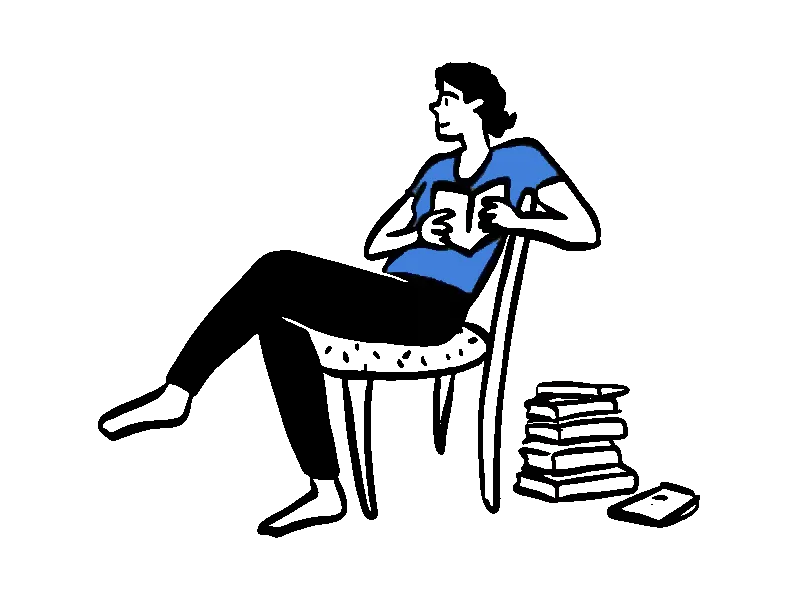

# REVIEW-04 — Chuyển động của nhân vật & asset (đợt 4)

Người review: web-visual-designer · Ngày: 2026-09-08
Phạm vi mới: chấm phần CHUYỂN ĐỘNG nhân vật/asset sau tích hợp + soát nhanh toàn trang không hồi quy.
Đã đọc: `index.html`, `app.js`, `style.css`, `login.html`, `_lab-motion.html`. Đối chiếu REVIEW-01b/02/03 (đều PASS).

Đã kiểm bằng mắt (Browser pane, tab riêng):
- Hero An (`sitting-reading-blue.webp`) — chụp 3 khung liên tiếp: cử động rõ, tự nhiên.
- Hero Bình (`reading-side-green.webp`) — pane 1000px, cử động xác nhận (fig-b chỉ hiện ≥900px).
- CTA sprint (`sprinting-blue.webp`) — 4 khung: vòng chạy nước rút.
- Login — nhân vật cử động, layout nguyên.
- Icon tính năng — đo transform giữa tween "pop": 0.58→1.11→0.99 (elastic chạy thật).
- Line boil — nét "meditating" rung giữa các khung; boil-on=true, boilCount=5.
- Hiệu năng, console, tải mobile, desktop 1440 tĩnh (shot.sh) — xem mục (d)/(e).

---

## (a) VERDICT

| Hạng mục | Kết quả |
|----------|---------|
| **Chuyển động nhân vật/asset** | **PASS** — có "sống" mà giữ được sự điềm tĩnh, không cướp mắt khỏi tiêu đề/CTA. |
| **Toàn trang sau tích hợp** | **PASS** — không hồi quy bố cục/typography; console sạch; CTA còn khá hơn nhờ runner động. |

Không có P0. Có 2 điểm P1 (đều thuộc kỹ thuật/tiếp cận, không phá thẩm mỹ) nên xử lý trước khi nộp.

Kết luận nhanh: hướng "cho nhân vật cử động" đã chọn ĐÚNG. WebP từng khung dùng chính bản animated của cùng
bộ doodle Pablo Stanley đang có, nên nhân vật động và doodle tĩnh khớp nét tuyệt đối. Line boil làm doodle tĩnh
"thở" mà gần như miễn phí về hiệu năng. Icon cử động có nghĩa, đúng lúc. Vấn đề còn lại: **ảnh WebP động không
tôn trọng `prefers-reduced-motion`/`?static`** và **một ảnh ẩn vẫn tải trên mobile** — cả hai sửa rẻ, asset đã có sẵn.

---

## (b) Bảng điểm (mỗi trục /10)

| # | Trục | Điểm | Ghi chú 1 dòng |
|---|------|:----:|----------------|
| 1 | Chất lượng cử động nhân vật | **9** | An/Bình đọc sách 60 khung, nhịp thở tự nhiên + float GSAP chồng lên = "sống" mà điềm tĩnh; sprint 4 khung hơi rời. |
| 2 | Phù hợp ngữ cảnh từng asset | **9** | Đọc ở hero, chạy nước rút ở CTA "kỳ thi" (bứt tốc), boil trên doodle tĩnh, login đọc "tiếp tục bài học" — đều khớp. |
| 3 | Đồng bộ phong cách 3 lớp | **8** | WebP (nét đậm) / doodle SVG+boil (nét vừa) / icon Iconoodle (nét mảnh) = phân tầng có chủ ý, cùng họ vẽ tay; WebP sắc ở DPR=1, có thể mềm nhẹ trên retina. |
| 4 | Hiệu năng & kỹ thuật | **8** | Boil 144fps (min 114 khi cuộn) — nhẹ; console sạch. Trừ: WebP bỏ qua reduced-motion/`?static`; fig-b 375KB tải phí trên mobile; attr `sprinting` sai kích thước. |
| 5 | Tổng thể sau tích hợp | **9** | Không hồi quy; CTA nâng cấp; login/mobile ổn; không tràn ngang (scrollW==375). |

**Trung bình ≈ 8.6/10 → PASS.**

### Bằng chứng cử động (khung theo khung)
- **An** (3 khung, cách ~0.4s): ngả người thư giãn, chân duỗi → nhổm dậy ngồi thẳng cầm sách đọc → ngả lại. Vòng lặp mượt (60 khung/33fps), nét đen dày sắc, áo xanh `--blue`. Chuyển động ở NỬA DƯỚI khung nhìn nên không tranh chấp với H1/CTA phía trên — đúng ý "sống mà không xao nhãng".
- **Bình**: cùng cơ chế, tư thế tay/sách đổi giữa khung; nét sắc ở 600px hiển thị.
- **Sprint** (4 khung, cách ~0.18s): chân trước/sau hoán đổi, thân nhún — đọc rõ là chạy nước rút. Vì chỉ 4 khung nên "bước" rời rạc hơn hẳn nhân vật đọc; động tác nhanh nên chấp nhận được, không thành lỗi.
- **Icon "pop"**: transform 0.58 (nhỏ, xoay) → 1.11 (vọt lố) → 0.99 (ổn định) = elastic đúng thiết kế.

---

## (c) Danh sách sửa

### P0 — KHÔNG có.

### P1 — nên sửa trước khi nộp

- **P1-1 · WebP động KHÔNG tôn trọng `prefers-reduced-motion` và `?static`.**
  Cờ `rm` trong `app.js:5` chỉ tắt GSAP + boil (return sớm ở L19). Ảnh WebP động là animated image → trình duyệt tự
  phát bất kể `rm` hay `?static`. Hệ quả: (a) người bật giảm-chuyển-động vẫn thấy An/Bình/runner cử động liên tục
  (chạm WCAG 2.2.2 Pause/Stop/Hide — nội dung tự lặp >5s); (b) ảnh "tĩnh" `?static` để chụp bố cục thực ra nhân vật
  vẫn nhảy khung. **Cách sửa rẻ, asset đã có:** bọc mỗi nhân vật bằng `<picture>` với nguồn tĩnh cho reduced-motion —
  bản SVG tĩnh cùng tư thế đã nằm sẵn trong `assets/doodles/`:
  ```html
  <picture>
    <source srcset="assets/doodles/sitting-reading-blue.svg" media="(prefers-reduced-motion: reduce)">
    
  </picture>
  ```
  Tương tự: hero fig-b → `reading-side-green.svg`; CTA runner → `sleek-blue.svg` (tư thế chạy) hoặc khung đầu của sprint;
  login → `sitting-reading-blue.svg`. (Muốn `?static` cũng đóng băng nhân vật để chụp: khi `rm` true, thêm 1 dòng JS đổi
  `img.src` sang bản `.svg` — nhưng `<picture>` đã lo ca reduced-motion, phần này tùy.)

- **P1-2 · Mobile tải phí `reading-side-green.webp` (~375KB) dù `display:none`.**
  Ở ≤900px `.fig-b` bị ẩn (đúng), nhưng `` vẫn được trình duyệt tải (đã đo: file có trong danh sách resource ở
  viewport 375). Sửa 1 thuộc tính: thêm `loading="lazy"` cho `.fig-b img` (và cho `.cta-art img`) → hoãn/không tải ảnh ngoài
  màn hình. Riêng mobile tiết kiệm ~375KB. (`<picture>` ở P1-1 cũng giải quyết luôn nếu source mobile trỏ bản nhẹ.)

### P2 — đánh bóng / mockup chấp nhận được

- **P2-1 · Thuộc tính kích thước `sprinting` sai.** `index.html:337` khai `width="960" height="720"` nhưng file thật **900×640**
  (đo `naturalWidth/Height`). Tỉ lệ khai 4:3 vs thật 1.406:1 → hộp giữ chỗ sai, có thể giật layout rất nhẹ trước khi ảnh tải.
  Sửa attr thành `width="900" height="640"`.
- **P2-2 · Sprint chỉ 4 khung** nên bước chạy rời. Nếu muốn mượt: xuất bản nhiều khung hơn từ nguồn, hoặc thêm 1 lớp GSAP
  (đã có float `y:-12`; có thể thêm `rotation: ±1.5` như REVIEW-03 gợi ý) để "che" nhịp giật. Không bắt buộc.
- **P2-3 · Sắc nét trên màn retina/4K.** Ở DPR=1 mọi WebP đều sắc (nguồn 800–900px hiển thị 217–600px = thu nhỏ). Trên DPR=2,
  hero fig-a hiển thị tới 560px = 1120px vật lý > 800px nguồn → mềm nhẹ. Nếu buổi bảo vệ trình chiếu màn retina/4K, cân nhắc
  xuất hero WebP ở ~1200×900 (đánh đổi dung lượng). Với máy chiếu thường thì bỏ qua.
- **P2-4 · `boil` `setInterval` chạy vô điều kiện** (chỉ dừng khi `document.hidden`, `app.js:118`). Hiệu năng hiện đã tốt nên
  không cấp thiết; nếu chạy trên máy yếu, bọc bằng `IntersectionObserver` để chỉ đổi seed khi có phần tử `.boil` trong khung.

---

## (d) Hiệu năng & console (đo thực)

- **Boil filter KHÔNG nặng.** Đứng yên tại vùng nhiều `.boil`: **144 FPS** (min 125). Cuộn liên tục qua toàn bộ vùng boil
  (about → samples → how): **144 FPS** (min 114). `feTurbulence numOctaves=2` + đổi seed 8fps trên 5 phần tử vẫn dư địa lớn.
  (Lưu ý: máy đo 144Hz mạnh; min 114 cho thấy biên an toàn tốt, nhưng không đại diện máy tích hợp yếu — P2-4 là bảo hiểm.)
- **Console sạch** (reload mới, `onlyErrors`): không còn `TypeError: $(...).forEach` — đó là rác đệm bản cũ như REVIEW-02/03 đã
  ghi; mã hiện hành dùng `$$` đúng.
- **Tải:** WebP là chi phí chính. fig-a `sitting-reading-blue` 355KB (above-fold, cần), fig-b `reading-side-green` 375KB,
  `sprinting-blue` 170KB. SVG doodle nén tốt (plant-green 200KB→~75KB, meditating→35KB…). GSAP 3 plugin ~50KB. Desktop tổng
  nhân vật ~900KB; sau P1-2 mobile bớt ~375KB.

---

## (e) Soát toàn trang (không hồi quy)

- **Desktop 1440 tĩnh** (shot.sh): hero cân, hai nhân vật + 4 thẻ UI thật + máy bay giấy + nét vẽ tay đủ; nét nhân vật sắc,
  khớp REVIEW-01b. CTA (đổi sang runner động) bố cục y nguyên REVIEW-03, runner sắc ở ~400px — **nâng cấp** so với runner tĩnh
  cũ vì ẩn dụ "nước rút về kỳ thi" nay động thật.
- **Mobile 375**: không tràn ngang (`scrollW==innerW==375`); fig-b ẩn đúng; runner CTA hiển thị lớn, sắc. (Còn P1-2 tải phí.)
- **Login**: nhân vật đọc cử động, quote Fraunces italic + panel hổ phách + form cân; fcard/badge ẩn ở hẹp đúng thiết kế.

---

## (f) Đề xuất thêm asset động (có giấy phép rõ, hợp gu)

Khuyến nghị **GIỮ line boil** cho doodle tĩnh (about/how/lessons): rẻ, perf tốt, khớp nét tuyệt đối. Chỉ thêm nhân vật động
nếu tìm được **đúng nguồn/gu** để không vỡ sự đồng bộ. Ưu tiên theo thứ tự:

1. **Open Doodles Animated (Jihan) trên LottieFiles** — https://lottiefiles.com/ (tìm "open doodles"). Chính nguồn đang dùng
   (Lottie Simple License), gốc Pablo Stanley CC0. Kiểm xem set này có sẵn bản động "meditating"/"unboxing" chưa — nếu có, xuất
   WebP như đã làm cho hero rồi thay `about-fig`/`how-fig`. **Đồng bộ 100%** vì cùng tay vẽ. (Nếu không có đúng tư thế → giữ boil.)
2. **Tận dụng WebP amber/green ĐÃ CÓ mà chưa dùng** (`assets/anim/reading-side-amber.webp`, `sitting-reading-amber.webp`…):
   thẻ "Bài học mẫu" số 1 (đang `reading-amber.svg` + boil) có thể đổi sang `reading-*.webp` động thật. Nhưng samples có 3 thẻ →
   nếu động cả ba sẽ +~1MB; cân nhắc chỉ 1 thẻ động làm điểm nhấn, hoặc giữ boil cho nhẹ.
3. **Humaaans** — https://www.humaaans.com/ (Pablo Stanley, miễn phí thương mại, ghép bộ phận). Cùng "gu" tác giả; animate bằng
   GSAP/SVG. Hợp nếu muốn nhân vật tùy biến tư thế cho từng section.
4. **DrawKit** — https://www.drawkit.com/ (nhiều bộ hand-drawn free, một số có bản animated). Kiểm license từng bộ.

TRÁNH: Storyset/Freepik animated và các bộ phẳng (flat) — đã loại đúng ở lab (`graduation`/`online-test`), trộn vào sẽ vỡ gu vẽ tay.

---

### Tóm tắt cho chủ dự án
Chuyển động nhân vật/asset **ĐẠT** và là bước tiến thật của trang. Làm 2 việc P1 trước khi nộp: (1) `<picture>` fallback SVG
tĩnh cho ca `prefers-reduced-motion` (asset đã có trong `assets/doodles/`), (2) `loading="lazy"` cho ảnh hero ẩn trên mobile.
Còn lại chỉ là đánh bóng. Không cần thêm asset động mới — line boil đang làm tốt vai trò; nếu muốn thêm thì bám đúng nguồn
Open Doodles/Humaaans (Pablo Stanley) để giữ đồng bộ.
